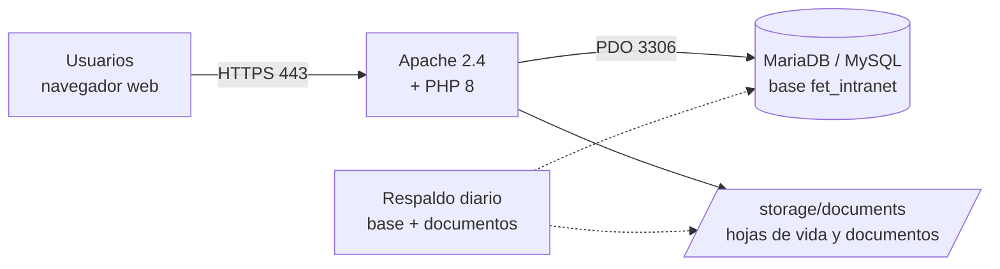

# Manual de despliegue de Pasantías FET 2.0.0

Pasantías FET es la plataforma web con la que la Fundación Escuela Tecnológica de Neiva Jesús Oviedo Pérez gestiona los documentos de las pasantías de sus estudiantes, las alianzas con empresas y las convocatorias de práctica y empleo. Este manual describe cómo instalar, configurar, poner en marcha, mantener y actualizar la versión 2.0.0 en un servidor de producción, y cómo preparar un ambiente local de pruebas. El uso funcional de la plataforma por parte de estudiantes, empresas, docentes y administradores se explica en el *Manual de usuario* (Rojas Narváez et al., 2026b).

El documento está dirigido al personal de sistemas o de infraestructura que tenga conocimientos básicos de la línea de comandos, del servidor web Apache y de las bases de datos MySQL o MariaDB. El procedimiento se probó en servidores Ubuntu Server 24.04 sin configuración previa; los resultados de esa prueba se presentan en el informe correspondiente (Rojas Narváez et al., 2026a). El código fuente está disponible en https://github.com/OrlandoRojasNa/fet-pasantias.

La Tabla 1 reúne los términos técnicos que se usan a lo largo del manual.

**Tabla 1**

*Términos utilizados en el manual*

| Término | Significado |
|---|---|
| Servidor de producción | Equipo en el que funciona la plataforma que usan estudiantes, empresas y docentes |
| Ambiente de pruebas | Instalación local, con datos de demostración, para probar sin afectar la producción |
| Archivo `.env` | Archivo de configuración privado con la conexión a la base de datos; nunca se publica |
| Instalador | Programa `database/install.php`, que crea o actualiza la base de datos |
| Etiqueta (*tag*) | Nombre de una versión publicada en el repositorio, por ejemplo `v2.0.0` |
| HTTPS | Conexión cifrada entre el navegador y el servidor |

## Arquitectura de despliegue

La plataforma está escrita en PHP 8 y no depende de paquetes externos, por lo que no requiere Composer ni Node.js en el servidor. Toda la información se guarda en una sola base de datos, llamada `fet_intranet` por defecto. Los documentos y las hojas de vida que suben los usuarios se almacenan con nombres aleatorios en la carpeta `storage/documents` y solo pueden descargarse a través de la aplicación, que valida los permisos de quien los solicita. Además, el archivo `.htaccess` del proyecto impide el acceso web a las carpetas internas (`config`, `database`, `storage`, `tests`, `docs` e `includes`) y a los archivos ocultos como `.env`. La Figura 1 muestra la relación entre estos componentes.

**Figura 1**

*Componentes del despliegue de Pasantías FET*



## Requisitos y descargas

El servidor debe cumplir los recursos mínimos de la Tabla 2. Los recursos recomendados dejan margen para el crecimiento de los documentos almacenados, que es el componente que más espacio ocupa con el tiempo.

**Tabla 2**

*Recursos del servidor*

| Recurso | Mínimo | Recomendado |
|---|---|---|
| Procesador | 1 vCPU | 2 vCPU |
| Memoria RAM | 2 GB | 4 GB |
| Disco | 10 GB | 20 GB o más |
| Sistema operativo | Ubuntu Server 22.04 LTS o Windows Server 2019 | Ubuntu Server 24.04 LTS |
| Red | Dirección IP pública o interna, puertos 80 y 443 | Dominio propio, por ejemplo `pasantias.fet.edu.co` |

El software necesario se indica en la Tabla 3. En Linux todos los componentes se instalan desde los repositorios del sistema operativo; en Windows se usa XAMPP, que reúne Apache, PHP y MariaDB en un solo instalador (Apache Friends, s.f.).

**Tabla 3**

*Software requerido*

| Componente | Versión | Observaciones |
|---|---|---|
| Apache HTTP Server | 2.4 | Con los módulos `rewrite` y `headers` activos y `AllowOverride All` |
| PHP | 8.1 o superior; probado con 8.2 y 8.3 | Con las extensiones `pdo_mysql`, `mbstring`, `fileinfo`, `curl` y `openssl` |
| MariaDB o MySQL | MariaDB 10.6 o MySQL 8.0 en adelante | Juego de caracteres `utf8mb4` |
| Git | 2.30 o superior | Para descargar y actualizar el código |
| Certbot | Versión vigente | Certificado HTTPS gratuito de Let's Encrypt, solo en Linux (Electronic Frontier Foundation, s.f.) |

Los programas que conviene descargar antes de empezar, con su sitio oficial, se listan en la Tabla 4.

**Tabla 4**

*Descargas*

| Programa | Uso | Sitio de descarga |
|---|---|---|
| XAMPP 8.2 (Windows) | Apache, PHP y MariaDB en un solo instalador | https://www.apachefriends.org/es/download.html |
| Git | Descargar el código y sus versiones | https://git-scm.com/downloads |
| Ubuntu Server LTS | Sistema operativo del servidor | https://ubuntu.com/download/server |
| Certbot | Certificado HTTPS | https://certbot.eff.org/ |
| Visual Studio Code (opcional) | Editar archivos de configuración | https://code.visualstudio.com/ |

## Ambientes

La plataforma se usa en dos ambientes, descritos en la Tabla 5. La diferencia principal está en los datos: el ambiente de pruebas trae cuentas de demostración con una contraseña conocida, mientras que la producción solo contiene un administrador inicial creado durante la instalación. Por esa razón, el instalador de producción debe ejecutarse siempre con la opción `--produccion`; sin ella crea las cuentas de demostración.

**Tabla 5**

*Ambientes de la plataforma*

| Ambiente | Propósito | Datos | Instalación |
|---|---|---|---|
| Producción | Uso real por estudiantes, empresas y docentes | Reales, sin cuentas de demostración | Apartados de instalación en Linux o Windows, con `--produccion` |
| Pruebas local | Probar cambios, capacitar y hacer las pruebas de usuario | Datos y cuentas de demostración | Apartado *Ambiente de pruebas local* |

## Instalación en un servidor Linux

Los comandos de este apartado se ejecutan en Ubuntu Server (Canonical, 2024) con un usuario que tenga permisos de `sudo`. En todos ellos, `pasantias.fet.edu.co` debe reemplazarse por el dominio real de la institución.

### Instalación automática

El programa `deploy/instalar_servidor.sh` ejecuta en orden todos los pasos de la instalación manual y deja programado el respaldo diario. Es la forma recomendada de instalar la plataforma en un servidor Ubuntu 22.04 o 24.04 recién instalado:

```bash
sudo apt install -y git
git clone https://github.com/OrlandoRojasNa/fet-pasantias.git ~/fet-pasantias
cd ~/fet-pasantias
sudo DOMINIO=pasantias.fet.edu.co \
     ADMIN_CORREO=coordinacion.pasantias@fet.edu.co \
     ADMIN_ID=NUMERO_DE_DOCUMENTO \
     ADMIN_CLAVE='ClaveSegura2026' \
     bash deploy/instalar_servidor.sh
```

Las variables que recibe el programa se explican en la Tabla 6. Puede ejecutarse de nuevo sobre una instalación existente sin perder datos. Los apartados siguientes describen los mismos pasos uno por uno, para quien prefiera hacerlos a mano o necesite adaptarlos.

**Tabla 6**

*Variables del instalador automático*

| Variable | Obligatoria | Uso |
|---|---|---|
| `DOMINIO` | Sí | Nombre del sitio, por ejemplo `pasantias.fet.edu.co` |
| `ADMIN_CORREO`, `ADMIN_ID`, `ADMIN_CLAVE` | Sí | Datos del administrador inicial; la clave debe tener 10 caracteres o más, con letras y números |
| `ADMIN_NOMBRE` | No | Nombre visible del administrador |
| `VERSION` | No | Etiqueta o rama que se instala; por defecto `main`, por ejemplo `v2.0.0` |
| `CERTBOT=1` | No | Solicita un certificado de Let's Encrypt; requiere un dominio público que apunte al servidor. Sin esta variable se usa un certificado autofirmado |
| `DB_PASS` | No | Clave del usuario de la base de datos; si no se indica, se genera una aleatoria, y si ya existe un `.env`, se conserva la suya |

### Instalación de los paquetes

El primer paso es actualizar el sistema e instalar Apache, MariaDB, Git y PHP con sus extensiones, y activar los módulos de Apache que usa la aplicación:

```bash
sudo apt update && sudo apt upgrade -y
sudo apt install -y apache2 mariadb-server git \
  php libapache2-mod-php php-mysql php-mbstring php-curl php-xml
sudo a2enmod rewrite headers
sudo systemctl enable --now apache2 mariadb
php -v        # debe mostrar PHP 8.1 o superior
```

### Base de datos y usuario propio

La instalación de MariaDB se asegura con `mysql_secure_installation`, que define la clave del usuario `root` y elimina los usuarios anónimos y la base de prueba. Después se crea la base de datos y un usuario exclusivo para la aplicación, con una contraseña larga y propia:

```bash
sudo mysql_secure_installation
sudo mysql
```

```sql
CREATE DATABASE fet_intranet CHARACTER SET utf8mb4 COLLATE utf8mb4_unicode_ci;
CREATE USER 'pasantias'@'localhost' IDENTIFIED BY 'CAMBIA_ESTA_CLAVE_LARGA';
GRANT ALL PRIVILEGES ON fet_intranet.* TO 'pasantias'@'localhost';
FLUSH PRIVILEGES;
EXIT;
```

### Descarga de la versión

El código se descarga en `/var/www/pasantias-fet` y se fija en la versión que se va a publicar. Mientras no exista la etiqueta `v2.0.0`, puede usarse la rama `main`:

```bash
sudo git clone https://github.com/OrlandoRojasNa/fet-pasantias.git /var/www/pasantias-fet
cd /var/www/pasantias-fet
sudo git checkout v2.0.0
```

### Configuración de la aplicación

La configuración se guarda en el archivo `.env`, que se crea a partir de la plantilla `.env.example`:

```bash
sudo cp .env.example .env
sudo nano .env
```

Para producción, el archivo debe quedar así:

```ini
APP_NAME="Pasantías FET"
APP_ENV=production
APP_BASE_URL=
DB_HOST=127.0.0.1
DB_PORT=3306
DB_NAME=fet_intranet
DB_USER=pasantias
DB_PASS=CAMBIA_ESTA_CLAVE_LARGA
```

El valor `APP_ENV=production` impide que el instalador cargue datos de demostración y oculta en la pantalla de acceso las cuentas de prueba. `APP_BASE_URL` queda vacío porque la plataforma se publica en la raíz del dominio; si se publicara en una subcarpeta, se escribiría su ruta, por ejemplo `/pasantias`.

A continuación se asignan los permisos. El servidor web solo necesita escribir en `storage`, y el `.env` debe quedar legible únicamente para él. La última instrucción evita que Git interprete estos cambios de permisos como modificaciones del código, lo que bloquearía las actualizaciones futuras:

```bash
sudo chown -R root:www-data /var/www/pasantias-fet
sudo find /var/www/pasantias-fet -type d -exec chmod 750 {} \;
sudo find /var/www/pasantias-fet -type f -exec chmod 640 {} \;
sudo chown -R www-data:www-data /var/www/pasantias-fet/storage
sudo chmod 640 /var/www/pasantias-fet/.env
sudo git -C /var/www/pasantias-fet config core.fileMode false
```

### Creación de la base de datos y del administrador inicial

El instalador crea las tablas y el primer administrador:

```bash
cd /var/www/pasantias-fet
sudo -u www-data php database/install.php --produccion \
  --admin-correo=coordinacion.pasantias@fet.edu.co \
  --admin-identificacion=NUMERO_DE_DOCUMENTO \
  --admin-nombre="Coordinación de Pasantías" \
  --admin-clave='ClaveSegura2026'
```

Cuando termina correctamente, responde con estas dos líneas:

```text
Administrador inicial creado: coordinacion.pasantias@fet.edu.co
Pasantías FET instalada y actualizada correctamente (modo producción, sin datos de demostración).
```

La clave del administrador debe tener al menos 10 caracteres, con letras y números. El administrador inicial solo se crea si todavía no existe un administrador activo, de modo que ejecutar de nuevo el instalador no lo duplica ni cambia su clave. Para que la clave no quede en el historial de comandos, puede pasarse en la variable `FET_ADMIN_PASS` en lugar de la opción `--admin-clave`, por ejemplo `sudo -u www-data env FET_ADMIN_PASS='...' php database/install.php --produccion ...`.

### Publicación del sitio en Apache

El sitio se publica con un archivo de configuración propio, `/etc/apache2/sites-available/pasantias-fet.conf`, que además agrega cabeceras de seguridad y registros separados (Apache Software Foundation, s.f.):

```apache
<VirtualHost *:80>
    ServerName pasantias.fet.edu.co
    DocumentRoot /var/www/pasantias-fet

    <Directory /var/www/pasantias-fet>
        Options -Indexes +FollowSymLinks
        AllowOverride All
        Require all granted
    </Directory>

    Header always set X-Content-Type-Options "nosniff"
    Header always set X-Frame-Options "SAMEORIGIN"
    Header always set Referrer-Policy "strict-origin-when-cross-origin"

    ErrorLog ${APACHE_LOG_DIR}/pasantias-fet-error.log
    CustomLog ${APACHE_LOG_DIR}/pasantias-fet-access.log combined
</VirtualHost>
```

El sitio se activa, se desactiva el sitio por defecto y se recarga Apache después de comprobar la sintaxis:

```bash
sudo a2ensite pasantias-fet.conf
sudo a2dissite 000-default.conf
sudo apache2ctl configtest && sudo systemctl reload apache2
```

### Activación de HTTPS

Cuando el servidor tiene un dominio público, Certbot obtiene un certificado gratuito de Let's Encrypt, configura la redirección de HTTP a HTTPS y programa su renovación automática:

```bash
sudo apt install -y certbot python3-certbot-apache
sudo certbot --apache -d pasantias.fet.edu.co --redirect
```

Con HTTPS activo, la plataforma marca la cookie de sesión como segura. Si el servidor solo es accesible dentro de la red de la institución, Certbot no puede validar el dominio. En ese caso se usa el certificado de la institución o, para pruebas, un certificado autofirmado, con el que el navegador mostrará una advertencia:

```bash
sudo a2enmod ssl
sudo openssl req -x509 -nodes -days 825 -newkey rsa:2048 -subj "/CN=pasantias.fet.edu.co" \
  -keyout /etc/ssl/private/pasantias-fet.key -out /etc/ssl/certs/pasantias-fet.crt
```

Luego se crea `/etc/apache2/sites-available/pasantias-fet-ssl.conf` con un bloque `<VirtualHost *:443>` igual al del apartado anterior, al que se agregan `SSLEngine on`, `SSLCertificateFile` y `SSLCertificateKeyFile`. En el sitio del puerto 80 se añade la redirección:

```apache
RewriteEngine On
RewriteRule ^ https://%{SERVER_NAME}%{REQUEST_URI} [END,R=301]
```

Finalmente se activan ambos sitios con `sudo a2ensite pasantias-fet-ssl.conf` y se recarga Apache.

### Ajustes de PHP para producción

En `/etc/php/8.*/apache2/php.ini` se dejan los siguientes valores y luego se reinicia Apache con `sudo systemctl restart apache2`. La aplicación limita cada archivo a 5 MB, así que los límites de PHP deben quedar por encima de ese valor:

```ini
display_errors = Off
log_errors = On
expose_php = Off
upload_max_filesize = 8M
post_max_size = 10M
session.cookie_httponly = 1
```

### Cortafuegos

El cortafuegos solo debe permitir el acceso remoto por SSH y el tráfico web. La base de datos escucha únicamente en `127.0.0.1`, por lo que no es necesario abrir el puerto 3306:

```bash
sudo ufw allow OpenSSH
sudo ufw allow 'Apache Full'
sudo ufw enable
```

### Ensayo en una máquina virtual

Antes de instalar en el servidor de la institución, todo el procedimiento puede ensayarse en una máquina virtual del propio computador con VirtualBox (Oracle, s.f.):

1. Descargar e instalar VirtualBox (https://www.virtualbox.org/wiki/Downloads) y la imagen ISO de Ubuntu Server 24.04 LTS.
2. Crear una máquina nueva de tipo *Linux, Ubuntu (64-bit)* con 2 GB de RAM, 2 procesadores y un disco de 20 GB, y asignarle la imagen ISO.
3. En *Configuración*, sección *Red*, elegir *Adaptador puente* para que la máquina obtenga una dirección de la red local. Si se usa *NAT*, agregar en *Reenvío de puertos* las reglas del puerto 8080 al 80 y del 8443 al 443.
4. Instalar Ubuntu Server con las opciones por defecto y marcar *Install OpenSSH server*.
5. Dentro de la máquina, ejecutar la instalación automática con `DOMINIO=pasantias.local`.
6. Consultar la dirección de la máquina con `ip -4 addr` y agregar en el archivo de hosts del computador la línea `IP_DE_LA_VM  pasantias.local`. En Windows ese archivo es `C:\Windows\System32\drivers\etc\hosts` y se edita como administrador.
7. Abrir `https://pasantias.local/`, o `https://localhost:8443/` si se usó NAT, aceptar la advertencia del certificado autofirmado y entrar con el administrador inicial.
8. Aplicar la verificación posterior al despliegue.

## Instalación en un servidor Windows

Si la institución dispone de un servidor Windows, la plataforma se instala con XAMPP siguiendo estos pasos:

1. Instalar XAMPP 8.2 en `C:\xampp` y registrar Apache y MySQL como servicios, marcando en el panel de XAMPP la casilla *Service* de cada uno para que arranquen con Windows.
2. Definir una contraseña para `root` y crear el usuario `pasantias` con los mismos comandos SQL del apartado *Base de datos y usuario propio*, desde la opción *SQL* de phpMyAdmin o desde `C:\xampp\mysql\bin\mysql.exe -u root -p`.
3. Clonar el proyecto en `C:\xampp\htdocs\pasantias-fet` con `git clone` y fijar la versión con `git checkout v2.0.0`.
4. Crear el `.env` como se indica en *Configuración de la aplicación*, con `APP_ENV=production` y `APP_BASE_URL=/pasantias-fet`, o vacío si se configura un *VirtualHost* hacia esa carpeta.
5. Ejecutar el instalador en modo de producción:

   ```powershell
   C:\xampp\php\php.exe C:\xampp\htdocs\pasantias-fet\database\install.php --produccion --admin-correo=coordinacion.pasantias@fet.edu.co --admin-identificacion=NUMERO --admin-nombre="Coordinación de Pasantías" --admin-clave=ClaveSegura2026
   ```

6. Aplicar en `C:\xampp\php\php.ini` los mismos valores de *Ajustes de PHP para producción*.
7. Configurar HTTPS con el certificado de la institución en `C:\xampp\apache\conf\extra\httpd-ssl.conf`.
8. Restringir phpMyAdmin al acceso local, dejando `Require local` en el bloque de `phpmyadmin` del archivo `C:\xampp\apache\conf\extra\httpd-xampp.conf`.

## Verificación posterior al despliegue

Antes de anunciar el lanzamiento, el responsable de la instalación debe comprobar los ocho puntos de la Tabla 7 y marcar la columna *Cumple*. El punto 5 es especialmente importante: el acceso con una cuenta de demostración debe fallar, porque esas cuentas no existen en producción.

**Tabla 7**

*Lista de verificación posterior al despliegue*

| N.º | Verificación | Resultado esperado | Cumple |
|---|---|---|---|
| 1 | Abrir `https://pasantias.fet.edu.co/` | Carga la pantalla de acceso con el candado de HTTPS |   |
| 2 | Abrir `http://pasantias.fet.edu.co/` | Redirige automáticamente a HTTPS |   |
| 3 | Entrar con el administrador inicial | Se abre el *Panel de pasantías* |   |
| 4 | Abrir `/.env`, `/config/database.php`, `/database/install.php` y `/storage/` | Respuesta *403 Forbidden* o *404*, nunca su contenido |   |
| 5 | Entrar con `admin@fet.edu.co` y la clave de demostración | El acceso es rechazado |   |
| 6 | Descargar el respaldo SQL desde *Usuarios* | Se descarga el archivo `.sql` con su huella SHA-256 |   |
| 7 | Crear una alianza de prueba, subir un PDF y descargarlo | El archivo se guarda en `storage/documents` y se descarga completo |   |
| 8 | Revisar `/var/log/apache2/pasantias-fet-error.log` | No hay errores de PHP |   |

Después del punto 7 conviene suspender la alianza de prueba desde *Alianzas*, con la opción *Editar o ampliar*, y desactivar su cuenta en *Usuarios*. La prueba automática `tests/smoke_test.php` usa las cuentas de demostración, por lo que solo debe ejecutarse en el ambiente de pruebas y nunca en producción.

## Puesta en marcha

Una vez verificado el servidor, el administrador carga la información inicial desde la propia plataforma, como se explica en el *Manual de usuario* (Rojas Narváez et al., 2026b). En primer lugar crea las cuentas de los docentes líderes de pasantías desde *Usuarios*, con la opción *Nuevo usuario* y el perfil *Docente líder de pasantías*. Después registra las empresas aliadas en *Alianzas*, con la opción *Nueva alianza*, indicando su convenio, su vigencia y sus cupos; este registro crea también la cuenta de la empresa. Luego crea las cuentas de los estudiantes con el perfil *Estudiante*; cuando son muchos, el área de sistemas puede cargarlos directamente en la tabla `users` con una contraseña temporal.

Las credenciales se entregan a cada persona por un canal seguro, como el correo institucional, y se les pide que guarden su contraseña. Por último, se anuncia el lanzamiento con la dirección de la plataforma y el enlace al manual de usuario.

## Operación

### Respaldo automático diario

En Linux, el respaldo se hace con el programa `/usr/local/bin/respaldo-pasantias.sh`, que guarda la base de datos y los documentos, conserva los últimos 30 días y deja los archivos legibles solo para el usuario `root`:

```bash
#!/bin/bash
set -e
umask 077
DESTINO=/var/backups/pasantias-fet
FECHA=$(date +%F)
mkdir -p "$DESTINO"
mysqldump --single-transaction -u pasantias -p'CAMBIA_ESTA_CLAVE_LARGA' fet_intranet | gzip > "$DESTINO/base-$FECHA.sql.gz"
tar -czf "$DESTINO/documentos-$FECHA.tar.gz" -C /var/www/pasantias-fet storage/documents
find "$DESTINO" -type f -mtime +30 -delete
```

El respaldo se programa todos los días a las 2:00 a. m.:

```bash
sudo chmod 700 /usr/local/bin/respaldo-pasantias.sh
echo "0 2 * * * root /usr/local/bin/respaldo-pasantias.sh" | sudo tee /etc/cron.d/respaldo-pasantias
```

La carpeta `/var/backups/pasantias-fet` debe copiarse periódicamente a otro equipo o a un almacenamiento externo. En Windows, el equivalente es una tarea del *Programador de tareas* que ejecute `C:\xampp\mysql\bin\mysqldump.exe` y comprima `storage\documents`. Además, el administrador puede descargar un respaldo de la base de datos en cualquier momento desde *Usuarios*, con la opción *Descargar respaldo SQL*.

### Restauración

Para restaurar un respaldo se detiene Apache, se cargan la base de datos y los documentos del día elegido y se vuelve a iniciar el servicio:

```bash
sudo systemctl stop apache2
gunzip -c /var/backups/pasantias-fet/base-AAAA-MM-DD.sql.gz | mysql -u pasantias -p fet_intranet
sudo tar -xzf /var/backups/pasantias-fet/documentos-AAAA-MM-DD.tar.gz -C /var/www/pasantias-fet
sudo chown -R www-data:www-data /var/www/pasantias-fet/storage
sudo systemctl start apache2
```

### Registros

La plataforma y el servidor llevan los tres registros de la Tabla 8. La bitácora de auditoría es la fuente principal para saber quién hizo cada acción; los registros de Apache sirven para diagnosticar errores técnicos.

**Tabla 8**

*Registros disponibles*

| Registro | Ubicación | Contenido |
|---|---|---|
| Bitácora de auditoría | En la plataforma, módulo *Reportes y auditoría* | Quién hizo qué y cuándo: accesos, aprobaciones, veredictos, descargas, respaldos y desbloqueos |
| Errores del servidor | `/var/log/apache2/pasantias-fet-error.log` | Errores de PHP y de Apache |
| Accesos web | `/var/log/apache2/pasantias-fet-access.log` | Todas las solicitudes HTTP |

## Actualización y reversión

### Actualización a una versión nueva

Toda actualización empieza con un respaldo. Después se descargan las versiones publicadas, se cambia a la nueva y se ejecuta el instalador, que aplica los cambios a la base de datos:

```bash
sudo /usr/local/bin/respaldo-pasantias.sh
cd /var/www/pasantias-fet
sudo git fetch --tags
git tag --sort=-v:refname | head -5
sudo git checkout vX.Y.Z
sudo -u www-data php database/install.php --produccion
sudo systemctl reload apache2
```

El instalador es idempotente: solo agrega lo que falta y migra columnas, sin borrar datos. El archivo `.env` y la carpeta `storage` no cambian con la actualización. Al terminar se repite la verificación posterior al despliegue.

### Reversión a la versión anterior

Si la versión nueva presenta un problema grave, se vuelve a la anterior con `sudo git checkout vVERSION_ANTERIOR` desde `/var/www/pasantias-fet`. Si la actualización modificó la base de datos, también debe restaurarse el respaldo tomado antes de actualizar.

## Lista de control de seguridad

La Tabla 9 reúne los controles de seguridad que dependen de la instalación y que deben revisarse en cada servidor. La aplicación incorpora además sus propios controles: las contraseñas se guardan cifradas con `password_hash`, todos los formularios tienen protección contra falsificación de peticiones (CSRF), las cuentas se bloquean tras cinco intentos fallidos, los permisos se validan por perfil en cada solicitud, los archivos se guardan con nombres aleatorios y se descargan de forma controlada, y todas las acciones relevantes quedan en la bitácora de auditoría.

**Tabla 9**

*Controles de seguridad de la instalación*

| Cumple | Control |
|---|---|
|   | La instalación se hizo con `--produccion` y `APP_ENV=production`, sin cuentas de demostración |
|   | La base de datos usa un usuario propio con contraseña larga, distinto de `root` |
|   | El `.env` tiene permisos 640 y no está en el repositorio |
|   | HTTPS está activo, con redirección desde HTTP |
|   | PHP tiene `display_errors = Off` |
|   | `AllowOverride All` está activo, para que el `.htaccess` bloquee las carpetas internas |
|   | Solo la carpeta `storage` tiene permisos de escritura para el servidor web |
|   | El cortafuegos está activo y el puerto 3306 está cerrado al exterior |
|   | phpMyAdmin no está expuesto a internet; en Windows tiene `Require local` |
|   | El respaldo diario está programado y se probó con una restauración |
|   | El sistema operativo y PHP se actualizan con regularidad |

## Ambiente de pruebas local

El ambiente de pruebas se usa para desarrollar, capacitar a los usuarios y hacer las pruebas de usuario. A diferencia de la producción, incluye datos y cuentas de demostración. Se instala en Windows con XAMPP:

1. Instalar XAMPP 8.2 en `C:\xampp` y, en el panel, pulsar *Start* en Apache y en MySQL. Conviene anotar el puerto de MySQL, que normalmente es 3306. Si MySQL no arranca porque ese puerto está ocupado, se cambia en *Config*, archivo `my.ini`, por ejemplo a 3307. Si Apache no arranca porque el puerto 80 está ocupado, se cambia `Listen 80` por `Listen 8080` en *Config*, archivo `httpd.conf`.
2. Descargar el proyecto en `C:\xampp\htdocs\PruebaFet`. También puede descargarse desde GitHub como archivo ZIP, con la opción *Code*, *Download ZIP*, y renombrar la carpeta a `PruebaFet`:

   ```powershell
   cd C:\xampp\htdocs
   git clone https://github.com/OrlandoRojasNa/fet-pasantias.git PruebaFet
   ```

3. Copiar `.env.example` como `.env`, dejar `APP_ENV=development` y cambiar `DB_PORT` si MySQL no usa el puerto 3306.
4. Crear la base de datos con los datos de demostración:

   ```powershell
   C:\xampp\php\php.exe C:\xampp\htdocs\PruebaFet\database\install.php
   ```

5. Abrir `http://localhost/PruebaFet/` y entrar con una de las cuentas de la Tabla 10. Todas usan la contraseña `FET2026*`.
6. Ejecutar la prueba automática, que recorre ocho flujos de la plataforma y deja la base como estaba. El resultado esperado es `Resultado: 8 de 8 flujos pasan.`

   ```powershell
   C:\xampp\php\php.exe C:\xampp\htdocs\PruebaFet\tests\smoke_test.php http://localhost/PruebaFet
   ```

7. De forma opcional, regenerar las capturas del manual de usuario. Este paso requiere Node.js y Playwright y una base recién instalada:

   ```powershell
   node docs\manual\generar_capturas.js docs\manual\img http://localhost/PruebaFet
   ```

**Tabla 10**

*Cuentas de demostración del ambiente de pruebas*

| Perfil | Correo |
|---|---|
| Administrador | admin@fet.edu.co |
| Docente líder de pasantías | docente@fet.edu.co |
| Estudiante | estudiante@fet.edu.co |
| Empresa aliada | empresa@fet.edu.co |

## Solución de problemas

La Tabla 11 recoge los problemas más frecuentes durante la instalación y la operación, con su causa probable y la forma de resolverlos.

**Tabla 11**

*Problemas frecuentes y su solución*

| Síntoma | Causa probable | Solución |
|---|---|---|
| `SQLSTATE[HY000] [2002]` al instalar | La base de datos está apagada o el puerto es incorrecto | Iniciar MariaDB o MySQL y revisar `DB_HOST` y `DB_PORT` |
| `SQLSTATE[HY000] [1045] Access denied` | Usuario o clave incorrectos | Revisar `DB_USER` y `DB_PASS` en el `.env` |
| `Falta el administrador inicial` | Modo de producción sin los datos del administrador | Agregar `--admin-correo`, `--admin-identificacion` y `--admin-clave` |
| `La clave del administrador debe tener al menos 10 caracteres` | Clave débil | Usar 10 caracteres o más, con letras y números |
| La página aparece sin estilos o los enlaces responden *Not Found* | `APP_BASE_URL` no coincide con la ruta real | Dejarlo vacío si el sitio está en la raíz o escribir la subcarpeta exacta |
| Error 500 en todas las páginas | `mod_rewrite` inactivo o `.htaccess` no permitido | Ejecutar `sudo a2enmod rewrite`, poner `AllowOverride All` y recargar Apache |
| `No fue posible guardar el archivo` | Sin permisos de escritura en `storage` | Ejecutar `sudo chown -R www-data:www-data storage` |
| `El archivo supera el límite de 5 MB` | Archivo demasiado grande | Comprimir el PDF; 5 MB es el límite de la plataforma |
| Un usuario quedó bloqueado | Cinco intentos fallidos de acceso | El administrador lo desbloquea en *Usuarios* o le asigna una contraseña nueva |
| Windows no reconoce el comando `php` | PHP no está en el PATH | Usar la ruta completa `C:\xampp\php\php.exe` |

## Soporte

La atención se organiza en los tres niveles de la Tabla 12. Los errores de la aplicación se reportan como *issue* en https://github.com/OrlandoRojasNa/fet-pasantias/issues, indicando los pasos para reproducirlos, la fecha y la hora, el perfil usado y una captura de pantalla. El reporte nunca debe incluir contraseñas.

**Tabla 12**

*Niveles de soporte*

| Nivel | Responsable | Atiende |
|---|---|---|
| 1. Usuarios | Administrador de la plataforma | Cuentas, contraseñas, bloqueos, alianzas y cupos |
| 2. Infraestructura | Área de sistemas de la institución | Servidor, base de datos, respaldos, HTTPS y actualizaciones |
| 3. Desarrollo | Equipo de Pasantías FET | Errores de la aplicación y nuevas versiones |

## Referencias

Apache Friends. (s.f.). *XAMPP* [Software]. Recuperado el 9 de noviembre de 2026, de https://www.apachefriends.org/es/

Apache Software Foundation. (s.f.). *Apache HTTP Server version 2.4 documentation*. Recuperado el 9 de noviembre de 2026, de https://httpd.apache.org/docs/2.4/

Canonical. (2024). *Ubuntu Server 24.04 LTS* [Sistema operativo]. https://ubuntu.com/server

Electronic Frontier Foundation. (s.f.). *Certbot* [Software]. Recuperado el 9 de noviembre de 2026, de https://certbot.eff.org/

Oracle. (s.f.). *VirtualBox* [Software]. Recuperado el 9 de noviembre de 2026, de https://www.virtualbox.org/

Rojas Narváez, O., Patiño Rico, H. F., & Sabogal García, J. J. (2026a). *Prueba de despliegue de Pasantías FET 2.0.0 en máquinas virtuales Ubuntu Server* [Informe técnico]. Fundación Escuela Tecnológica de Neiva.

Rojas Narváez, O., Patiño Rico, H. F., & Sabogal García, J. J. (2026b). *Manual de usuario de Pasantías FET 2.0.0* [Manual]. Fundación Escuela Tecnológica de Neiva.
