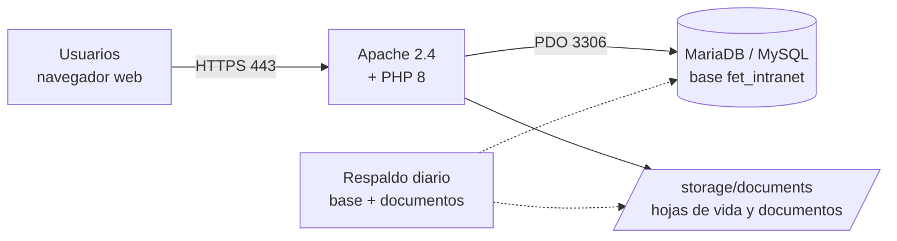

# Manual de despliegue

## Pasantías FET · Plataforma de gestión documental de pasantías

| | |
|---|---|
| **Producto** | Pasantías FET |
| **Versión del producto** | 2.0.0 |
| **Versión del documento** | 1.0 |
| **Fecha** | Noviembre de 2026 |
| **Institución** | Fundación Escuela Tecnológica de Neiva «Jesús Oviedo Pérez» · Campus Rivera, Huila |
| **Elaborado por** | Orlando Rojas Narváez · Hernán Felipe Patiño Rico · Juan José Sabogal García |
| **Repositorio** | https://github.com/OrlandoRojasNa/fet-pasantias |
| **Clasificación** | Uso interno: equipo técnico y de infraestructura |

### Control de cambios

| Versión | Fecha | Descripción | Autor |
|---|---|---|---|
| 1.0 | 05/11/2026 | Primera versión para el lanzamiento de la versión 2.0.0 | Equipo Pasantías FET |

---

## Contenido

1. [Introducción](#1-introducción)
2. [Arquitectura de despliegue](#2-arquitectura-de-despliegue)
3. [Requisitos y descargas](#3-requisitos-y-descargas)
4. [Ambientes](#4-ambientes)
5. [Instalación en producción (servidor Linux)](#5-instalación-en-producción-servidor-linux)
   - [Instalación automática](#50-instalación-automática-recomendada)
   - [Probar en una máquina virtual (VirtualBox)](#510-probar-el-despliegue-en-una-máquina-virtual-virtualbox)
6. [Instalación en producción (servidor Windows)](#6-instalación-en-producción-servidor-windows)
7. [Verificación posterior al despliegue](#7-verificación-posterior-al-despliegue)
8. [Puesta en marcha](#8-puesta-en-marcha)
9. [Operación: respaldos, restauración y registros](#9-operación-respaldos-restauración-y-registros)
10. [Actualización y reversión](#10-actualización-y-reversión)
11. [Lista de control de seguridad](#11-lista-de-control-de-seguridad)
12. [Ambiente de pruebas local (XAMPP)](#12-ambiente-de-pruebas-local-xampp)
13. [Solución de problemas](#13-solución-de-problemas)
14. [Soporte](#14-soporte)

---

## 1. Introducción

### 1.1 Propósito

Este manual describe cómo instalar, configurar, poner en marcha, mantener y actualizar **Pasantías FET** en un servidor de producción, y cómo montar un ambiente local de pruebas.

### 1.2 Alcance

Cubre la instalación del servidor web, el lenguaje PHP y la base de datos; la configuración segura de la aplicación; la creación del administrador inicial; los respaldos; las actualizaciones y la reversión a una versión anterior. No cubre el uso funcional de la plataforma, que se explica en el [Manual de usuario](manual/MANUAL_USUARIO.md).

### 1.3 Público objetivo

Personal de sistemas o de infraestructura con conocimientos básicos de la línea de comandos, de un servidor web (Apache) y de MySQL/MariaDB.

### 1.4 Glosario

| Término | Significado |
|---|---|
| **Servidor de producción** | Equipo donde corre la plataforma que usan estudiantes, empresas y docentes. |
| **Ambiente de pruebas** | Instalación local, con datos de demostración, para probar sin afectar la producción. |
| **`.env`** | Archivo de configuración privado con la conexión a la base de datos. Nunca se publica. |
| **Instalador** | Script `database/install.php`, que crea o actualiza la base de datos. |
| **Etiqueta (tag)** | Nombre de una versión publicada en el repositorio, por ejemplo `v2.0.0`. |
| **HTTPS / TLS** | Conexión cifrada entre el navegador y el servidor. |

---

## 2. Arquitectura de despliegue



- **Aplicación:** PHP 8 sin dependencias externas (no requiere Composer ni Node.js).
- **Base de datos:** una sola base, `fet_intranet` por defecto.
- **Archivos:** los documentos y hojas de vida se guardan con nombres aleatorios en `storage/documents`. Solo se descargan a través de la aplicación, que valida los permisos.
- **Protección de carpetas:** el `.htaccess` del proyecto bloquea el acceso web a `config`, `database`, `storage`, `tests`, `docs`, `includes` y a los archivos ocultos como `.env`.

---

## 3. Requisitos y descargas

### 3.1 Servidor

| Recurso | Mínimo | Recomendado |
|---|---|---|
| CPU | 1 vCPU | 2 vCPU |
| Memoria RAM | 2 GB | 4 GB |
| Disco | 10 GB | 20 GB o más (crece con los documentos) |
| Sistema operativo | Ubuntu Server 22.04 LTS / Windows Server 2019 | Ubuntu Server 24.04 LTS |
| Red | IP pública o interna, puertos 80 y 443 | Dominio propio, por ejemplo `pasantias.fet.edu.co` |

### 3.2 Software

| Componente | Versión | Notas |
|---|---|---|
| Apache HTTP Server | 2.4 | Módulos `rewrite` y `headers` activos, y `AllowOverride All`. |
| PHP | 8.1 o superior (probado con 8.2 y 8.3) | Extensiones: `pdo_mysql`, `mbstring`, `fileinfo`, `curl` y `openssl`. |
| MariaDB o MySQL | MariaDB 10.6+ o MySQL 8.0+ | Juego de caracteres `utf8mb4`. |
| Git | 2.30+ | Para descargar y actualizar el código. |
| Certbot | Actual | Certificado HTTPS gratuito de Let's Encrypt (Linux). |

### 3.3 Descargas comunes

| Programa | Para qué | Enlace |
|---|---|---|
| **XAMPP 8.2** (Windows) | Apache, PHP y MariaDB en un solo instalador | https://www.apachefriends.org/es/download.html |
| **Git** | Descargar el código y sus versiones | https://git-scm.com/downloads |
| **Ubuntu Server LTS** | Sistema operativo del servidor | https://ubuntu.com/download/server |
| **Certbot** | Certificado HTTPS | https://certbot.eff.org/ |
| **Visual Studio Code** (opcional) | Editar configuraciones | https://code.visualstudio.com/ |
| **Navegador** (Chrome, Edge o Firefox) | Usar y verificar la plataforma | Viene con el sistema operativo |

---

## 4. Ambientes

| Ambiente | Para qué | Datos | Cómo se instala |
|---|---|---|---|
| **Producción** | Uso real por estudiantes, empresas y docentes | Reales. Sin cuentas de demostración. | Secciones 5 o 6, con `--produccion` |
| **Pruebas local** | Probar cambios, capacitar y hacer las pruebas de usuario | Datos y cuentas de demostración | Sección 12 (XAMPP) |

> **Importante:** nunca instales producción sin la opción `--produccion`. Sin ella, el instalador crea cuentas de demostración con una contraseña conocida.

---

## 5. Instalación en producción (servidor Linux)

Los comandos se ejecutan en Ubuntu Server con un usuario que tenga `sudo`. Reemplaza `pasantias.fet.edu.co` por el dominio real.

### 5.0 Instalación automática (recomendada)

El script `deploy/instalar_servidor.sh` ejecuta en orden los pasos 5.1 a 5.9 y deja programado el respaldo diario. Úsalo en un servidor Ubuntu 22.04 o 24.04 recién instalado:

```bash
sudo apt install -y git
git clone https://github.com/OrlandoRojasNa/fet-pasantias.git ~/fet-pasantias
cd ~/fet-pasantias
sudo DOMINIO=pasantias.fet.edu.co \
     ADMIN_CORREO=coordinacion.pasantias@fet.edu.co \
     ADMIN_ID=NUMERO_DE_DOCUMENTO \
     ADMIN_CLAVE='ClaveSegura2026' \
     bash deploy/instalar_servidor.sh
```

| Variable | Obligatoria | Uso |
|---|---|---|
| `DOMINIO` | Sí | Nombre del sitio, por ejemplo `pasantias.fet.edu.co`. |
| `ADMIN_CORREO`, `ADMIN_ID`, `ADMIN_CLAVE` | Sí | Datos del administrador inicial. La clave debe tener 10 caracteres o más, con letras y números. |
| `ADMIN_NOMBRE` | No | Nombre visible del administrador. |
| `VERSION` | No | Etiqueta o rama a instalar (por defecto `main`). Por ejemplo `v2.0.0`. |
| `CERTBOT=1` | No | Pide un certificado de Let's Encrypt. Requiere un dominio público que apunte al servidor. Sin esta variable, el script usa un certificado autofirmado. |
| `DB_PASS` | No | Clave del usuario de base de datos. Si no se da, se genera una aleatoria; si ya existe un `.env`, se conserva la suya. |

El script se puede volver a ejecutar sin perder datos. El resto de esta sección explica los mismos pasos uno por uno, para quien prefiera hacerlo a mano o necesite adaptarlos.

### 5.1 Instalar los paquetes

```bash
sudo apt update && sudo apt upgrade -y
sudo apt install -y apache2 mariadb-server git \
  php libapache2-mod-php php-mysql php-mbstring php-curl php-xml
sudo a2enmod rewrite headers
sudo systemctl enable --now apache2 mariadb
php -v        # debe mostrar PHP 8.1 o superior
```

### 5.2 Asegurar la base de datos y crear su usuario

```bash
sudo mysql_secure_installation   # define la clave de root y elimina usuarios anónimos y la base de prueba
sudo mysql
```

Dentro de la consola de MariaDB (usa una contraseña larga y propia):

```sql
CREATE DATABASE fet_intranet CHARACTER SET utf8mb4 COLLATE utf8mb4_unicode_ci;
CREATE USER 'pasantias'@'localhost' IDENTIFIED BY 'CAMBIA_ESTA_CLAVE_LARGA';
GRANT ALL PRIVILEGES ON fet_intranet.* TO 'pasantias'@'localhost';
FLUSH PRIVILEGES;
EXIT;
```

### 5.3 Descargar la versión a publicar

```bash
sudo git clone https://github.com/OrlandoRojasNa/fet-pasantias.git /var/www/pasantias-fet
cd /var/www/pasantias-fet
sudo git checkout v2.0.0     # versión publicada (o main si aún no hay etiqueta)
```

### 5.4 Configurar la aplicación

```bash
sudo cp .env.example .env
sudo nano .env
```

Este es el contenido para producción:

```ini
APP_NAME="Pasantías FET"
APP_ENV=production
APP_BASE_URL=
DB_HOST=127.0.0.1
DB_PORT=3306
DB_NAME=fet_intranet
DB_USER=pasantias
DB_PASS=CAMBIA_ESTA_CLAVE_LARGA
```

- `APP_ENV=production` hace que el instalador nunca cargue datos de demostración.
- `APP_BASE_URL` va vacío porque la plataforma queda en la raíz del dominio. Si quedara en una subcarpeta, escribe su ruta, por ejemplo `/pasantias`.

Ahora asigna los permisos. El servidor web solo necesita escribir en `storage`, y el `.env` queda legible solo para él:

```bash
sudo chown -R root:www-data /var/www/pasantias-fet
sudo find /var/www/pasantias-fet -type d -exec chmod 750 {} \;
sudo find /var/www/pasantias-fet -type f -exec chmod 640 {} \;
sudo chown -R www-data:www-data /var/www/pasantias-fet/storage
sudo chmod 640 /var/www/pasantias-fet/.env
sudo git -C /var/www/pasantias-fet config core.fileMode false   # que git no tome los permisos como cambios al actualizar
```

### 5.5 Crear la base de datos y el administrador inicial

```bash
cd /var/www/pasantias-fet
sudo -u www-data php database/install.php --produccion \
  --admin-correo=coordinacion.pasantias@fet.edu.co \
  --admin-identificacion=NUMERO_DE_DOCUMENTO \
  --admin-nombre="Coordinación de Pasantías" \
  --admin-clave='ClaveSegura2026'
```

Si todo sale bien, el instalador responde:

```text
Administrador inicial creado: coordinacion.pasantias@fet.edu.co
Pasantías FET instalada y actualizada correctamente (modo producción, sin datos de demostración).
```

- La clave del administrador debe tener **al menos 10 caracteres, con letras y números**.
- El administrador inicial solo se crea si aún no existe un administrador activo. Volver a correr el instalador no lo duplica ni cambia su clave.
- Para que la clave no quede en el historial de comandos, puedes pasarla en la variable `FET_ADMIN_PASS` en lugar de `--admin-clave`: `sudo -u www-data env FET_ADMIN_PASS='...' php database/install.php --produccion ...`

### 5.6 Publicar el sitio en Apache

Crea el archivo `/etc/apache2/sites-available/pasantias-fet.conf`:

```apache
<VirtualHost *:80>
    ServerName pasantias.fet.edu.co
    DocumentRoot /var/www/pasantias-fet

    <Directory /var/www/pasantias-fet>
        Options -Indexes +FollowSymLinks
        AllowOverride All
        Require all granted
    </Directory>

    Header always set X-Content-Type-Options "nosniff"
    Header always set X-Frame-Options "SAMEORIGIN"
    Header always set Referrer-Policy "strict-origin-when-cross-origin"

    ErrorLog ${APACHE_LOG_DIR}/pasantias-fet-error.log
    CustomLog ${APACHE_LOG_DIR}/pasantias-fet-access.log combined
</VirtualHost>
```

Actívalo:

```bash
sudo a2ensite pasantias-fet.conf
sudo a2dissite 000-default.conf
sudo apache2ctl configtest && sudo systemctl reload apache2
```

### 5.7 Activar HTTPS

```bash
sudo apt install -y certbot python3-certbot-apache
sudo certbot --apache -d pasantias.fet.edu.co --redirect
```

Certbot instala el certificado, redirige HTTP a HTTPS y lo renueva automáticamente. Con HTTPS activo, la plataforma marca la cookie de sesión como segura.

**Servidor interno sin dominio público.** Si el servidor solo es accesible dentro de la red de la FET, Certbot no puede validar el dominio. En ese caso usa el certificado de la institución o, para pruebas, uno autofirmado (el navegador mostrará una advertencia):

```bash
sudo a2enmod ssl
sudo openssl req -x509 -nodes -days 825 -newkey rsa:2048 -subj "/CN=pasantias.fet.edu.co" \
  -keyout /etc/ssl/private/pasantias-fet.key -out /etc/ssl/certs/pasantias-fet.crt
```

Luego crea `/etc/apache2/sites-available/pasantias-fet-ssl.conf` con un `<VirtualHost *:443>` igual al de la sección 5.6, más `SSLEngine on`, `SSLCertificateFile` y `SSLCertificateKeyFile`. Agrega la redirección al sitio del puerto 80:

```apache
RewriteEngine On
RewriteRule ^ https://%{SERVER_NAME}%{REQUEST_URI} [END,R=301]
```

Activa ambos sitios con `sudo a2ensite pasantias-fet-ssl.conf` y recarga Apache.

### 5.8 Ajustar PHP para producción

Edita `/etc/php/8.*/apache2/php.ini` y deja estos valores:

```ini
display_errors = Off
log_errors = On
expose_php = Off
upload_max_filesize = 8M
post_max_size = 10M
session.cookie_httponly = 1
```

Luego reinicia Apache con `sudo systemctl restart apache2`.

> La aplicación limita cada archivo a 5 MB. Los valores de PHP deben quedar por encima de ese límite.

### 5.9 Cortafuegos

```bash
sudo ufw allow OpenSSH
sudo ufw allow 'Apache Full'
sudo ufw enable
```

La base de datos solo escucha en `127.0.0.1`, así que no hay que abrir el puerto 3306.

### 5.10 Probar el despliegue en una máquina virtual (VirtualBox)

Antes de instalar en el servidor de la FET, se puede ensayar todo en una máquina virtual del propio computador:

1. Descarga e instala **VirtualBox** (https://www.virtualbox.org/wiki/Downloads) y la imagen ISO de **Ubuntu Server 24.04 LTS** (https://ubuntu.com/download/server).
2. En VirtualBox, crea una máquina nueva de tipo **Linux / Ubuntu (64-bit)** con 2 GB de RAM, 2 CPU y un disco de 20 GB, y asígnale la ISO.
3. En **Configuración → Red**, elige **Adaptador puente** para que la máquina tenga una IP de tu red. Con **NAT**, agrega en **Reenvío de puertos** las reglas `8080 → 80` y `8443 → 443`.
4. Instala Ubuntu Server con las opciones por defecto y marca **Install OpenSSH server**.
5. Dentro de la máquina, ejecuta la [instalación automática](#50-instalación-automática-recomendada) con `DOMINIO=pasantias.local`.
6. Consulta la IP de la máquina con `ip -4 addr`. En tu computador, agrega al archivo de hosts la línea `IP_DE_LA_VM  pasantias.local`. En Windows el archivo es `C:\Windows\System32\drivers\etc\hosts` y se edita como administrador.
7. Abre `https://pasantias.local/` (o `https://localhost:8443/` si usaste NAT). Acepta la advertencia del certificado autofirmado y entra con el administrador inicial.
8. Recorre la [verificación de la sección 7](#7-verificación-posterior-al-despliegue).

El informe de una ejecución completa de este ensayo, con sus evidencias, está en [`docs/pruebas-despliegue/INFORME_DESPLIEGUE.md`](pruebas-despliegue/INFORME_DESPLIEGUE.md).

---

## 6. Instalación en producción (servidor Windows)

Para un servidor Windows de la institución:

1. Instala **XAMPP 8.2** en `C:\xampp` y registra **Apache** y **MySQL** como servicios. En el panel de XAMPP, marca la casilla **Service** de cada uno para que arranquen con Windows.
2. Define una contraseña para `root` y crea el usuario `pasantias` con los mismos comandos SQL de la sección 5.2, desde **phpMyAdmin → SQL** o desde `C:\xampp\mysql\bin\mysql.exe -u root -p`.
3. Clona el proyecto en `C:\xampp\htdocs\pasantias-fet` (`git clone ...` y `git checkout v2.0.0`).
4. Crea el `.env` como en la sección 5.4, con `APP_ENV=production` y `APP_BASE_URL=/pasantias-fet`, o vacío si configuras un *VirtualHost* hacia esa carpeta.
5. Ejecuta el instalador en modo producción:

   ```powershell
   C:\xampp\php\php.exe C:\xampp\htdocs\pasantias-fet\database\install.php --produccion --admin-correo=coordinacion.pasantias@fet.edu.co --admin-identificacion=NUMERO --admin-nombre="Coordinación de Pasantías" --admin-clave=ClaveSegura2026
   ```

6. En `C:\xampp\php\php.ini` aplica los mismos valores de la sección 5.8.
7. Configura HTTPS con el certificado de la institución, en `C:\xampp\apache\conf\extra\httpd-ssl.conf`.
8. Restringe phpMyAdmin a acceso local. En `C:\xampp\apache\conf\extra\httpd-xampp.conf`, deja `Require local` en el bloque de `phpmyadmin`.

---

## 7. Verificación posterior al despliegue

Marca cada punto antes de anunciar el lanzamiento:

| # | Verificación | Resultado esperado | ✔ |
|---|---|---|---|
| 1 | Abrir `https://pasantias.fet.edu.co/` | Carga la pantalla de acceso con candado HTTPS | ☐ |
| 2 | Abrir `http://pasantias.fet.edu.co/` | Redirige automáticamente a HTTPS | ☐ |
| 3 | Entrar con el administrador inicial | Abre el *Panel de pasantías* | ☐ |
| 4 | Abrir `/.env`, `/config/database.php`, `/database/install.php` y `/storage/` | *403 Forbidden* o *404*, nunca su contenido | ☐ |
| 5 | Entrar con `admin@fet.edu.co` y `FET2026*` | **Debe fallar**: no hay cuentas de demostración | ☐ |
| 6 | **Usuarios → Descargar respaldo SQL** | Se descarga el `.sql` con su huella SHA-256 | ☐ |
| 7 | Crear una alianza de prueba, subir un PDF y descargarlo | El archivo se guarda en `storage/documents` y se descarga | ☐ |
| 8 | Revisar `/var/log/apache2/pasantias-fet-error.log` | Sin errores de PHP | ☐ |

Después de la verificación 7, suspende la alianza de prueba desde **Alianzas → Editar o ampliar** y desactiva su cuenta en **Usuarios**.

> La prueba automática `tests/smoke_test.php` usa las cuentas de demostración. Ejecútala solo en el ambiente de pruebas (sección 12), nunca en producción.

---

## 8. Puesta en marcha

Una vez verificado el servidor, el administrador carga la información inicial desde la propia plataforma (ver el [Manual de usuario](manual/MANUAL_USUARIO.md#7-perfil-administrador)):

1. **Docentes líderes de pasantías:** en **Usuarios → Nuevo usuario**, con el perfil *Docente líder de pasantías*.
2. **Empresas aliadas:** en **Alianzas → Nueva alianza**, registrando la empresa, su convenio, su vigencia y sus **cupos**. Esto crea también la cuenta de la empresa.
3. **Estudiantes:** en **Usuarios → Nuevo usuario**, con el perfil *Estudiante*. Para cargar muchos a la vez, el área de sistemas puede importarlos directamente en la tabla `users` con una contraseña temporal.
4. **Entregar las credenciales** a cada persona por un canal seguro (correo institucional) y pedirles que guarden su contraseña.
5. **Anunciar el lanzamiento** con la dirección de la plataforma y el enlace al Manual de usuario.

---

## 9. Operación: respaldos, restauración y registros

### 9.1 Respaldo automático diario (Linux)

Crea el archivo `/usr/local/bin/respaldo-pasantias.sh`:

```bash
#!/bin/bash
set -e
umask 077                                     # los respaldos solo los lee root
DESTINO=/var/backups/pasantias-fet
FECHA=$(date +%F)
mkdir -p "$DESTINO"
mysqldump --single-transaction -u pasantias -p'CAMBIA_ESTA_CLAVE_LARGA' fet_intranet | gzip > "$DESTINO/base-$FECHA.sql.gz"
tar -czf "$DESTINO/documentos-$FECHA.tar.gz" -C /var/www/pasantias-fet storage/documents
find "$DESTINO" -type f -mtime +30 -delete    # conserva 30 días
```

Prográmalo todos los días a las 2:00 a. m.:

```bash
sudo chmod 700 /usr/local/bin/respaldo-pasantias.sh
echo "0 2 * * * root /usr/local/bin/respaldo-pasantias.sh" | sudo tee /etc/cron.d/respaldo-pasantias
```

Copia periódicamente `/var/backups/pasantias-fet` a otro equipo o a un almacenamiento externo.

En Windows, programa una tarea en el **Programador de tareas** que ejecute `C:\xampp\mysql\bin\mysqldump.exe` y comprima `storage\documents`.

**Respaldo manual:** el administrador puede descargar un respaldo en cualquier momento desde **Usuarios → Descargar respaldo SQL**.

### 9.2 Restauración

```bash
sudo systemctl stop apache2
gunzip -c /var/backups/pasantias-fet/base-AAAA-MM-DD.sql.gz | mysql -u pasantias -p fet_intranet
sudo tar -xzf /var/backups/pasantias-fet/documentos-AAAA-MM-DD.tar.gz -C /var/www/pasantias-fet
sudo chown -R www-data:www-data /var/www/pasantias-fet/storage
sudo systemctl start apache2
```

### 9.3 Registros

| Registro | Ubicación | Contenido |
|---|---|---|
| Bitácora de auditoría | La plataforma, en **Reportes y auditoría** | Quién hizo qué y cuándo: accesos, aprobaciones, veredictos, descargas, respaldos y desbloqueos. |
| Errores del servidor | `/var/log/apache2/pasantias-fet-error.log` | Errores de PHP y de Apache. |
| Accesos web | `/var/log/apache2/pasantias-fet-access.log` | Todas las solicitudes HTTP. |

---

## 10. Actualización y reversión

### 10.1 Actualizar a una versión nueva

```bash
sudo /usr/local/bin/respaldo-pasantias.sh          # 1. respaldo previo, obligatorio
cd /var/www/pasantias-fet
sudo git fetch --tags
git tag --sort=-v:refname | head -5                  # 2. ver las versiones disponibles
sudo git checkout vX.Y.Z                             # 3. cambiar a la versión nueva
sudo -u www-data php database/install.php --produccion   # 4. aplicar los cambios a la base
sudo systemctl reload apache2
```

Luego repite la [verificación de la sección 7](#7-verificación-posterior-al-despliegue).

El instalador es **idempotente**: solo agrega lo que falta y migra columnas, sin borrar datos. El `.env` y la carpeta `storage` no cambian con la actualización.

### 10.2 Volver a la versión anterior

Si la versión nueva presenta un problema grave:

```bash
cd /var/www/pasantias-fet
sudo git checkout vVERSION_ANTERIOR
```

Si la actualización cambió la base de datos, restaura además el respaldo tomado en el paso 1 (sección 9.2).

---

## 11. Lista de control de seguridad

| ✔ | Control |
|---|---|
| ☐ | Instalación hecha con `--produccion` y `APP_ENV=production`, sin cuentas de demostración. |
| ☐ | La base de datos usa un usuario propio con contraseña larga, no `root`. |
| ☐ | El `.env` tiene permisos 640 y no está en el repositorio. |
| ☐ | HTTPS activo, con redirección desde HTTP. |
| ☐ | `display_errors = Off` en PHP. |
| ☐ | `AllowOverride All` activo, para que el `.htaccess` bloquee las carpetas internas. |
| ☐ | Solo `storage` tiene permisos de escritura para el servidor web. |
| ☐ | Cortafuegos activo, con el puerto 3306 cerrado al exterior. |
| ☐ | phpMyAdmin no está expuesto a internet (en Windows, `Require local`). |
| ☐ | Respaldo diario programado y probado con una restauración. |
| ☐ | Sistema operativo y PHP actualizados con regularidad. |

Controles que la aplicación ya trae: contraseñas cifradas con `password_hash`, protección CSRF en todos los formularios, bloqueo de la cuenta tras 5 intentos fallidos, validación de permisos por perfil en cada solicitud, archivos con nombres aleatorios y descargas controladas, y bitácora de auditoría.

---

## 12. Ambiente de pruebas local (XAMPP)

Usa este ambiente para desarrollar, capacitar y hacer las pruebas de usuario. Incluye datos y cuentas de demostración.

1. **Instala XAMPP 8.2** en `C:\xampp` y, en el panel, pulsa **Start** en **Apache** y en **MySQL**. Anota el puerto de MySQL; normalmente es 3306.
   - Si MySQL no arranca porque el puerto 3306 está ocupado, cambia el puerto en **Config → my.ini** (por ejemplo a `3307`).
   - Si Apache no arranca porque el puerto 80 está ocupado, cambia `Listen 80` a `Listen 8080` en **Config → httpd.conf**.
2. **Descarga el proyecto** en `C:\xampp\htdocs\PruebaFet`:

   ```powershell
   cd C:\xampp\htdocs
   git clone https://github.com/OrlandoRojasNa/fet-pasantias.git PruebaFet
   ```

   Otra opción: en GitHub, **Code → Download ZIP**, descomprimir y renombrar la carpeta a `PruebaFet`.
3. **Configura** el archivo: copia `.env.example` como `.env`. Deja `APP_ENV=development` y cambia `DB_PORT` si tu MySQL no usa el 3306.
4. **Crea la base de datos con datos de demostración:**

   ```powershell
   C:\xampp\php\php.exe C:\xampp\htdocs\PruebaFet\database\install.php
   ```

5. **Abre** `http://localhost/PruebaFet/` y entra con una de estas cuentas. La contraseña de todas es `FET2026*`.

   | Perfil | Correo |
   |---|---|
   | Administrador | admin@fet.edu.co |
   | Docente líder de pasantías | docente@fet.edu.co |
   | Estudiante | estudiante@fet.edu.co |
   | Empresa aliada | empresa@fet.edu.co |

6. **Ejecuta la prueba automática.** Recorre 8 flujos y deja la base como estaba:

   ```powershell
   C:\xampp\php\php.exe C:\xampp\htdocs\PruebaFet\tests\smoke_test.php http://localhost/PruebaFet
   ```

   El resultado esperado es `Resultado: 8 de 8 flujos pasan.`

7. **Regenera las capturas del manual** (opcional). Requiere Node.js y Playwright, y una base recién instalada:

   ```powershell
   node docs\manual\generar_capturas.js docs\manual\img http://localhost/PruebaFet
   ```

---

## 13. Solución de problemas

| Síntoma | Causa probable | Solución |
|---|---|---|
| `SQLSTATE[HY000] [2002]` al instalar | La base de datos está apagada o el puerto es incorrecto | Inicia MariaDB/MySQL y revisa `DB_HOST` y `DB_PORT`. |
| `SQLSTATE[HY000] [1045] Access denied` | Usuario o clave incorrectos | Revisa `DB_USER` y `DB_PASS` en el `.env`. |
| `Falta el administrador inicial` | Modo producción sin los datos del administrador | Agrega `--admin-correo`, `--admin-identificacion` y `--admin-clave`. |
| `La clave del administrador debe tener al menos 10 caracteres` | Clave débil | Usa 10 caracteres o más, con letras y números. |
| La página sale sin estilos o los enlaces dan *Not Found* | `APP_BASE_URL` no coincide con la ruta real | Déjalo vacío si el sitio está en la raíz o escribe la subcarpeta exacta (`/PruebaFet`). |
| Error 500 en todas las páginas | `mod_rewrite` inactivo o `.htaccess` no permitido | Ejecuta `sudo a2enmod rewrite` y pon `AllowOverride All`; luego recarga Apache. |
| `No fue posible guardar el archivo` | Sin permisos de escritura en `storage` | Ejecuta `sudo chown -R www-data:www-data storage`. |
| `El archivo supera el límite de 5 MB` | Archivo demasiado grande | Comprime el PDF. Los 5 MB son el límite de la plataforma. |
| Un usuario quedó bloqueado | 5 intentos fallidos | El administrador usa **Usuarios → Desbloquear** o le asigna una contraseña nueva. |
| *"php" no se reconoce como un comando* (Windows) | PHP no está en el PATH | Usa la ruta completa `C:\xampp\php\php.exe`. |

---

## 14. Soporte

| Nivel | Responsable | Atiende |
|---|---|---|
| 1. Usuarios | Administrador de la plataforma | Cuentas, contraseñas, bloqueos, alianzas y cupos. |
| 2. Infraestructura | Área de sistemas de la FET | Servidor, base de datos, respaldos, HTTPS y actualizaciones. |
| 3. Desarrollo | Equipo Pasantías FET | Errores de la aplicación y nuevas versiones. Se reportan como *issue* en el repositorio. |

Para reportar un error, abre un *issue* en https://github.com/OrlandoRojasNa/fet-pasantias/issues con los pasos para reproducirlo, la fecha y hora, el perfil usado y una captura. **No incluyas contraseñas.**
