# Manual de usuario de Pasantías FET 2.0.0

Pasantías FET es la plataforma con la que la Fundación Escuela Tecnológica de Neiva Jesús Oviedo Pérez gestiona el proceso de pasantías de sus estudiantes. En ella se registran las alianzas con las empresas y sus cupos de pasantes, se publican las convocatorias de pasantía y las ofertas laborales, se reciben las postulaciones con la hoja de vida de cada estudiante y se lleva la documentación de cada pasantía, desde el plan de práctica hasta el certificado. El docente líder de pasantías revisa, califica y aprueba esos documentos, y cada acción queda registrada para su auditoría.

Este manual explica, perfil por perfil, qué puede hacer cada usuario y cómo hacerlo. Está dirigido a estudiantes, empresas aliadas, docentes líderes de pasantías y administradores. La instalación y el mantenimiento del servidor se tratan en el *Manual de despliegue*. Las capturas de pantalla usan datos de ejemplo, por lo que los nombres, las empresas y las fechas de la plataforma real serán distintos. A lo largo del texto, los nombres de botones, menús y campos aparecen en cursiva, por ejemplo *Nueva publicación*, igual que los estados de los registros, como *En revisión*.

## Perfiles de usuario

La plataforma tiene cuatro perfiles, descritos en la Tabla 1. Cada persona entra con un solo perfil y ve únicamente los módulos que le corresponden.

**Tabla 1**

*Perfiles de usuario de la plataforma*

| Perfil | Quién lo usa | Qué hace en la plataforma |
|---|---|---|
| Estudiante | Estudiante de la FET que realiza o busca su pasantía | Se postula a convocatorias y ofertas laborales, sube los documentos de su pasantía y consulta sus notas y su resultado |
| Empresa aliada | Empresa con convenio vigente con la FET | Publica convocatorias de pasantía según sus cupos y ofertas laborales, selecciona pasantes, avala sus documentos y evalúa su desempeño |
| Docente líder de pasantías | Docente responsable del proceso de pasantías | Verifica las publicaciones, asigna responsables, califica los documentos, emite el veredicto final y audita el proceso |
| Administrador | Coordinación de pasantías o área de sistemas | Registra alianzas y cupos, administra las cuentas y los respaldos y supervisa todo el proceso |

## Requisitos para usar la plataforma

Para usar la plataforma basta con un equipo conectado a internet, un navegador actualizado y una cuenta creada por el administrador. Los archivos que se suben tienen restricciones de formato y tamaño, que se resumen en la Tabla 2.

**Tabla 2**

*Requisitos de uso*

| Requisito | Detalle |
|---|---|
| Equipo | Computador, tableta o celular con conexión a internet |
| Navegador | Google Chrome, Microsoft Edge, Mozilla Firefox o Safari en una versión reciente |
| Cuenta | Creada por el administrador de la plataforma |
| Archivos | Hoja de vida en PDF. Documentos de pasantía en PDF, imagen (PNG, JPG o WEBP), Office (DOCX, XLSX o PPTX), CSV, TXT o ZIP. Máximo 5 MB por archivo |

## Acceso a la plataforma

### Obtención de una cuenta

Los datos de estudiantes y docentes provienen de la base de datos de la universidad: cuando la plataforma está conectada con ella, cada estudiante con matrícula vigente y cada docente ya tiene su cuenta y entra con su usuario y su contraseña institucionales. Mientras esa conexión no esté activa, las cuentas las crea el administrador y la coordinación de pasantías entrega a cada estudiante y docente su usuario y su contraseña inicial. Si un dato personal, como el nombre o el programa, está equivocado, debe corregirse en la universidad y no en la plataforma. Las empresas reciben su cuenta cuando se registra la alianza con la FET; su usuario es el NIT o el correo de acceso de la empresa.

### Ingreso

Para ingresar se abre la dirección de la plataforma que entregó la FET, se escribe el número de identificación, el NIT o el correo, junto con la contraseña, y se pulsa *Ingresar* (ver Figura 1). La casilla *Mantener mi sesión en este equipo* solo debe marcarse en un equipo propio, nunca en uno compartido.

**Figura 1**

*Pantalla de acceso*

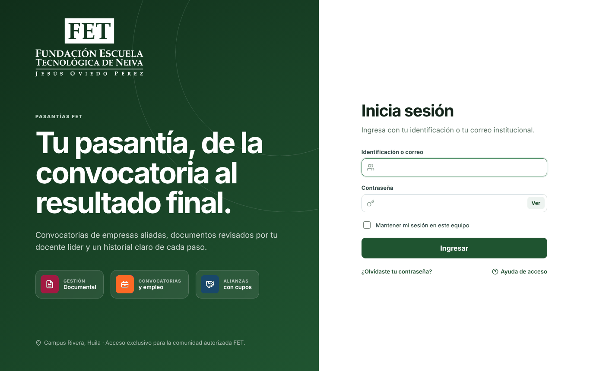

### Contraseña olvidada o cuenta bloqueada

Por seguridad, la cuenta se bloquea temporalmente después de cinco intentos fallidos. Si olvidaste la contraseña, pulsa *¿Olvidaste tu contraseña?* en la pantalla de acceso y escribe tu correo: el administrador recibe la solicitud y te asigna una contraseña nueva. La pantalla no confirma si el correo está registrado, para no dar pistas a terceros. El administrador también puede desbloquear la cuenta desde el módulo *Usuarios*.

### Cierre de sesión

La sesión se cierra con el botón de salida, la flecha que aparece a la derecha del nombre en la parte superior de la pantalla. En un equipo compartido conviene cerrarla siempre al terminar.

## Elementos comunes de la pantalla

Todas las pantallas comparten la misma estructura. A la izquierda está el menú, que muestra solo los módulos del perfil: un estudiante ve *Inicio*, *Pasantías*, *Convocatorias y empleo* y *Guía de uso*; el docente y el administrador ven además *Alianzas* y *Reportes y auditoría*, y el administrador también *Usuarios*. En la parte superior están el botón *Tutorial*, que recorre paso a paso la pantalla actual con explicaciones para cada perfil; la campana de notificaciones, cuyo número indica los avisos sin leer, y el botón de salida.

El módulo *Guía de uso* resume el flujo de trabajo de cada perfil y responde las dudas más comunes (ver Figura 2).

**Figura 2**

*Guía de uso del estudiante*

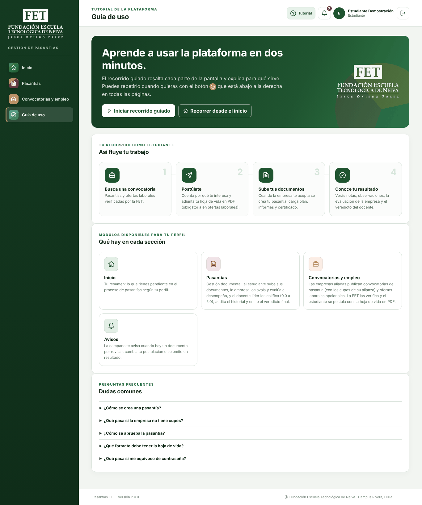

## El proceso de una pasantía

El proceso completo pasa por los cuatro perfiles en el orden de la Tabla 3. Cada paso queda registrado en la bitácora de auditoría, con quién lo hizo y cuándo, y genera notificaciones para las personas involucradas.

**Tabla 3**

*Pasos del proceso de una pasantía*

| Paso | Responsable | Acción |
|---|---|---|
| 1 | Administrador | Registra la alianza con la empresa y le asigna cupos de pasantes |
| 2 | Empresa aliada | Publica la convocatoria de pasantía y la envía a verificación |
| 3 | Docente líder | Verifica la convocatoria y la publica para los estudiantes |
| 4 | Estudiante | Se postula con su motivación y su hoja de vida |
| 5 | Empresa aliada | Acepta la postulación; la plataforma crea la pasantía y ocupa un cupo |
| 6 | Docente líder | Se asigna como docente de la pasantía y define sus fechas |
| 7 | Estudiante | Sube sus documentos: plan de práctica, informes y certificado |
| 8 | Empresa aliada | Avala los documentos y evalúa el desempeño del pasante |
| 9 | Docente líder | Califica cada documento de 0.0 a 5.0 o lo devuelve para corrección |
| 10 | Docente líder | Emite el veredicto final, aprobada o reprobada, y el cupo se libera |

## Perfil de estudiante

### Inicio

Al entrar, el estudiante ve el estado de su pasantía y accesos directos a las convocatorias de pasantía abiertas, a las ofertas laborales, a sus postulaciones en trámite y a los documentos que debe corregir (ver Figura 3).

**Figura 3**

*Inicio del estudiante*

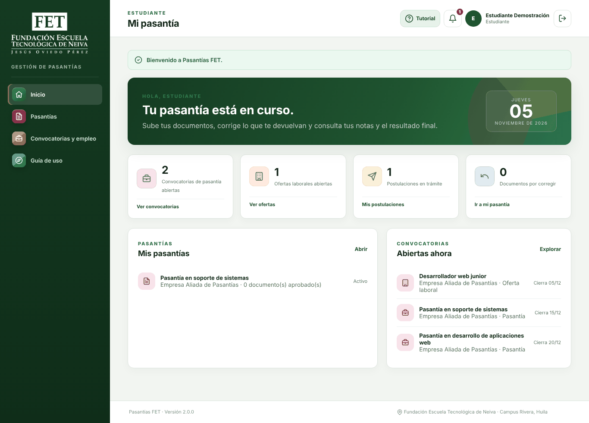

### Postulación a una convocatoria u oferta laboral

Las publicaciones disponibles están en *Convocatorias y empleo*, donde las pestañas *Todas*, *Pasantías* y *Ofertas laborales* permiten filtrarlas (ver Figura 4). Para postularte, pulsa *Postularme* en una convocatoria de pasantía o *Aplicar con mi hoja de vida* en una oferta laboral. En el formulario escribe por qué te interesa y adjunta tu hoja de vida en PDF, de 5 MB como máximo, y pulsa *Enviar postulación* (ver Figura 5). La hoja de vida es obligatoria en las ofertas laborales y opcional, aunque recomendable, en las convocatorias de pasantía.

**Figura 4**

*Convocatorias y ofertas disponibles para el estudiante*

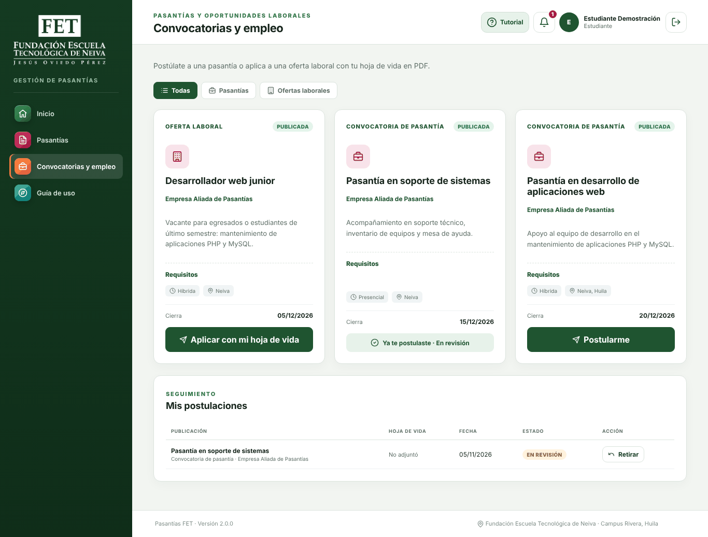

**Figura 5**

*Formulario de postulación*

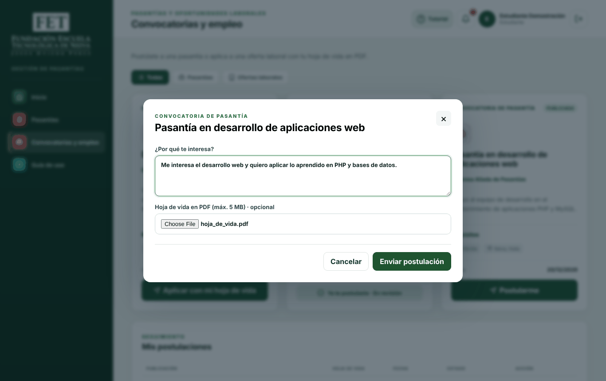

Después de enviarla, la tarjeta queda marcada con *Ya te postulaste* y la postulación aparece en *Mis postulaciones* con su estado: *Enviada*, *En revisión*, *Aceptada* o *No seleccionada* (ver Figura 6). Mientras no haya sido aceptada, la postulación puede retirarse.

**Figura 6**

*Postulación registrada*

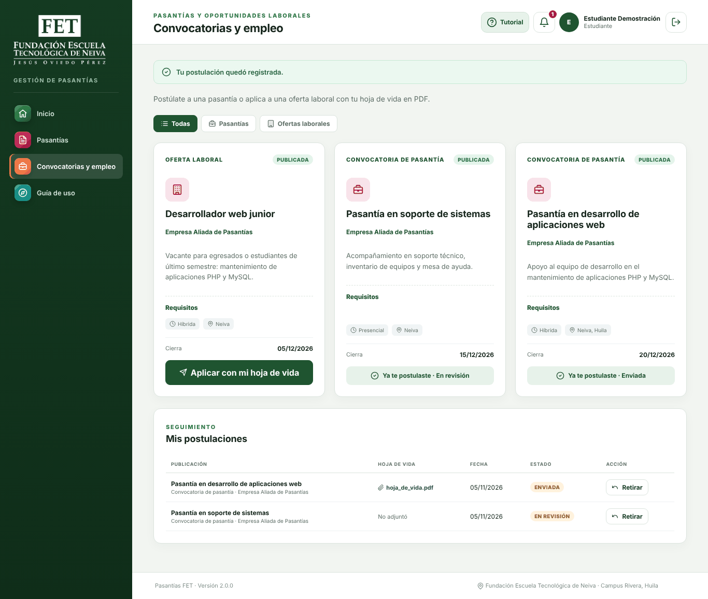

### Consulta de la pasantía

Cuando la empresa acepta tu postulación a una pasantía, la plataforma crea la pasantía y te avisa con una notificación. Para verla, entra a *Pasantías* y pulsa *Abrir* (ver Figura 7). El detalle muestra la empresa evaluadora, el docente líder asignado, el periodo, los documentos aprobados y el promedio de notas (ver Figura 8).

**Figura 7**

*Listado de pasantías del estudiante*

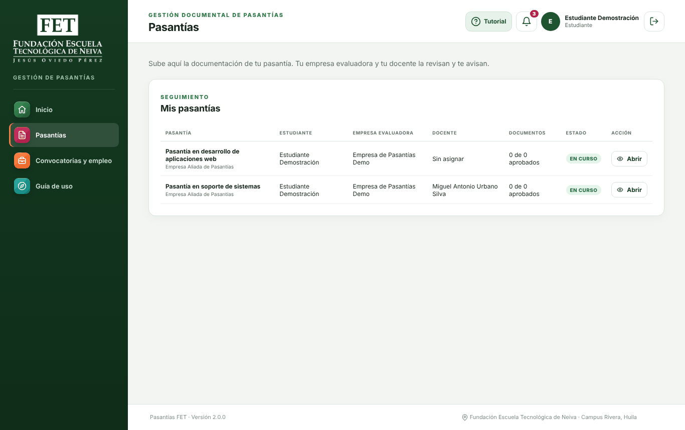

**Figura 8**

*Detalle de la pasantía*

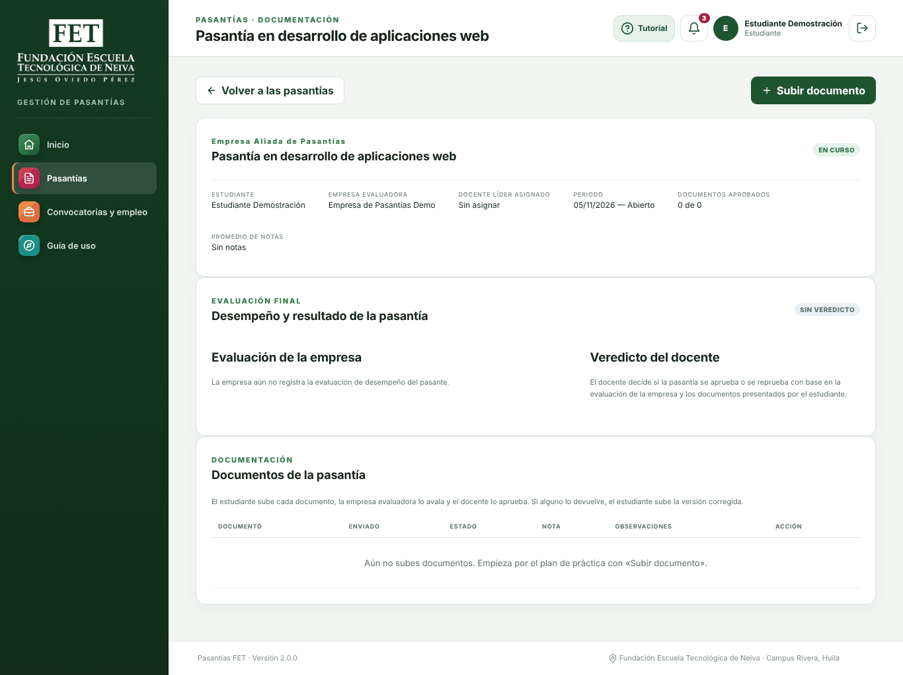

### Envío de documentos

En el detalle de la pasantía, pulsa *Subir documento*, elige el tipo (*Plan de práctica*, *Informe parcial*, *Informe final*, *Evaluación de la empresa*, *Certificado* u *Otro documento*), escribe un título si lo deseas, selecciona el archivo y pulsa *Enviar documento* (ver Figura 9). El documento queda en estado *Enviado*, y la empresa evaluadora y el docente reciben una notificación (ver Figura 10).

**Figura 9**

*Formulario para subir un documento*

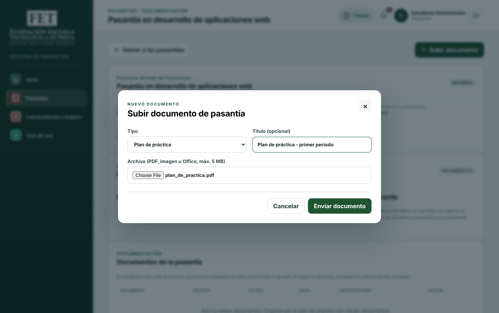

**Figura 10**

*Documento enviado*

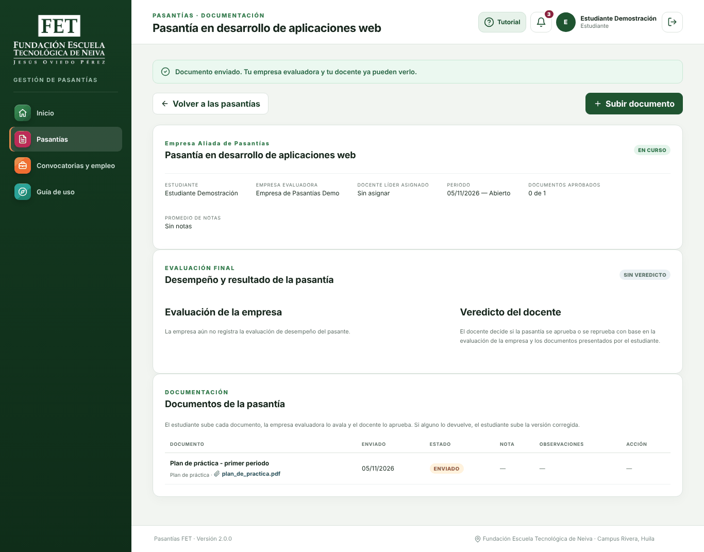

### Corrección de un documento devuelto

Si la empresa o el docente devuelven un documento, sus observaciones aparecen en la columna *Observaciones* junto con el botón *Corregir*. Al pulsarlo se adjunta el archivo corregido y se explica qué se cambió. La nota anterior se borra y el documento vuelve a revisión.

### Consulta del resultado final

Cuando el docente emite el veredicto, la pasantía pasa a *Finalizada*. En ese momento el estudiante puede ver la evaluación de la empresa, el veredicto del docente con su justificación y la nota de cada documento (ver Figura 11).

**Figura 11**

*Resultado final de la pasantía*

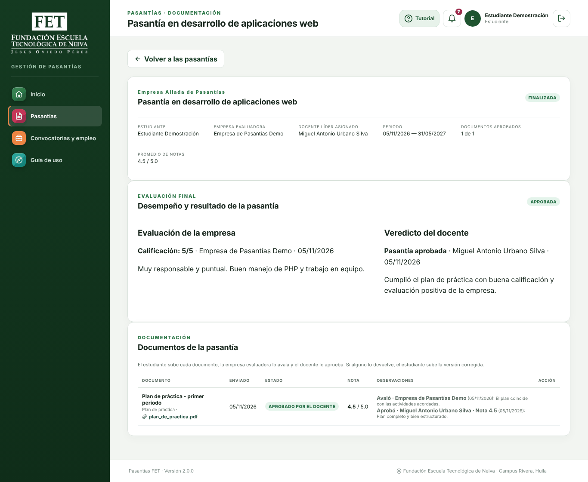

### Notificaciones

La campana y la página de avisos muestran cada cambio relevante: la aceptación de una postulación, el aval, la aprobación o la devolución de un documento y el veredicto final (ver Figura 12).

**Figura 12**

*Notificaciones del estudiante*

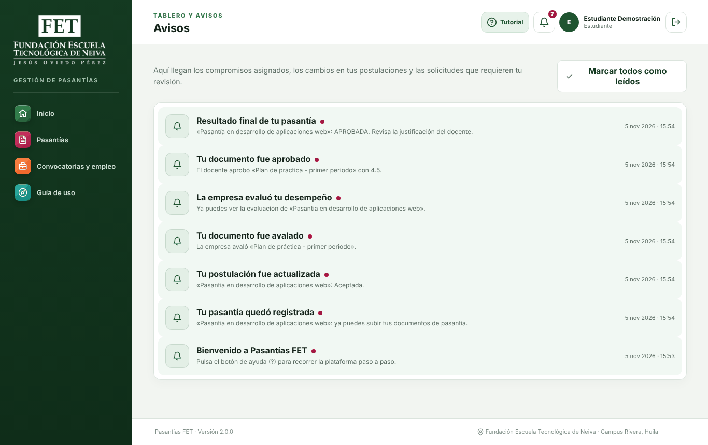

## Perfil de empresa aliada

Una empresa solo puede publicar convocatorias de pasantía si tiene una alianza vigente con la FET. El administrador registra esa alianza y define cuántos cupos de pasantes tiene la empresa.

### Inicio

El inicio de la empresa muestra la franja de su alianza y resume sus pasantes activos, sus convocatorias y las postulaciones recibidas (ver Figura 13).

**Figura 13**

*Inicio de la empresa aliada*

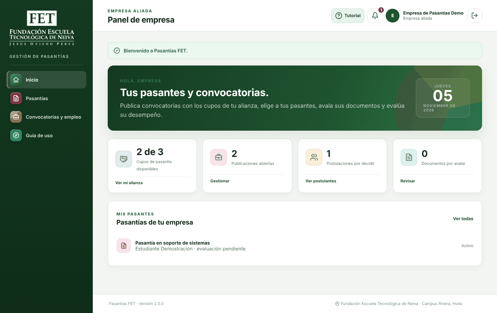

### Alianza y cupos

La franja de la alianza aparece también en *Convocatorias y empleo*, con el código del convenio, su estado, los cupos en uso, los cupos disponibles y la fecha de vigencia (ver Figura 14). Cada pasantía activa ocupa un cupo, que se libera cuando la pasantía termina.

**Figura 14**

*Convocatorias de la empresa con la franja de la alianza*

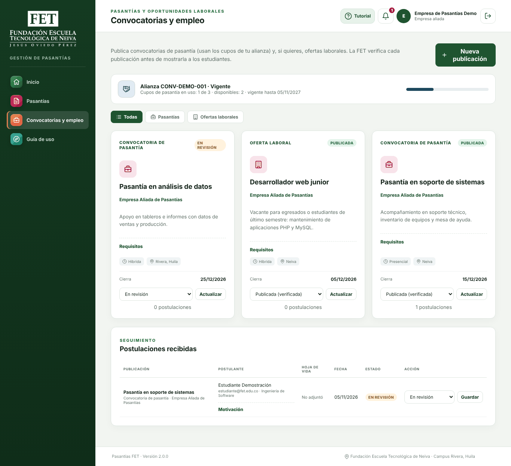

### Publicación de una convocatoria u oferta laboral

Para publicar, pulsa *Nueva publicación* y completa el formulario (ver Figura 15). El campo *Tipo* distingue entre la convocatoria de pasantía, que usa los cupos de la alianza, y la oferta laboral, que no los usa y exige que el estudiante adjunte su hoja de vida. Además se indican la modalidad (presencial, híbrida o remota), la ubicación, la fecha de cierre, la descripción y los requisitos. En el campo *Publicación* se elige entre enviarla a verificación de la FET o guardarla como borrador, y se termina con *Guardar publicación*.

**Figura 15**

*Formulario de nueva publicación*

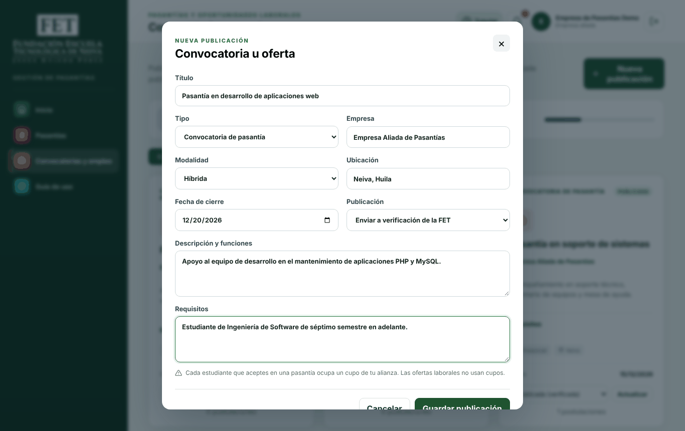

La publicación queda *En revisión* hasta que un docente líder o el administrador la verifica; a partir de ese momento los estudiantes pueden verla. Más adelante, la empresa puede pasarla a *Borrador* o *Cerrada* eligiendo el estado y pulsando *Cambiar estado*.

### Revisión de postulaciones y aceptación de pasantes

Las postulaciones aparecen en *Postulaciones recibidas*, con el nombre del estudiante, su motivación y el enlace a su hoja de vida. Cada postulación tiene los botones *Aceptar*, *En revisión* y *No seleccionar*, y la plataforma pide confirmación antes de aceptar o descartar (ver Figura 16).

**Figura 16**

*Postulaciones recibidas*

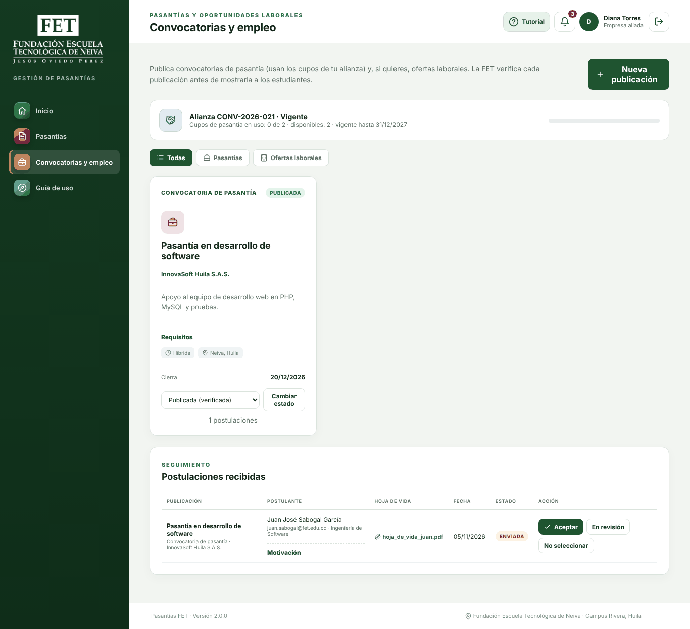

Al aceptar una postulación a una pasantía, la plataforma comprueba que la empresa tenga un cupo libre y crea la pasantía del estudiante, con la empresa como evaluadora (ver Figura 17). Si no hay cupos disponibles, lo indica y no la crea.

**Figura 17**

*Pasantías de la empresa*

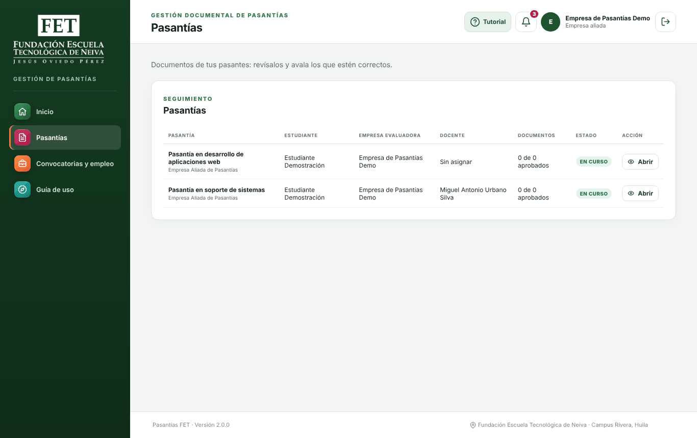

### Aval de los documentos del pasante

Para revisar un documento, abre la pasantía en *Pasantías* y pulsa *Revisar* en la tabla de documentos. Allí se elige *Avalar el documento* o *Devolver con observaciones*, se escriben las observaciones, que son obligatorias cuando el documento se devuelve, y se pulsa *Guardar decisión* (ver Figura 18).

**Figura 18**

*Aval de un documento por parte de la empresa*

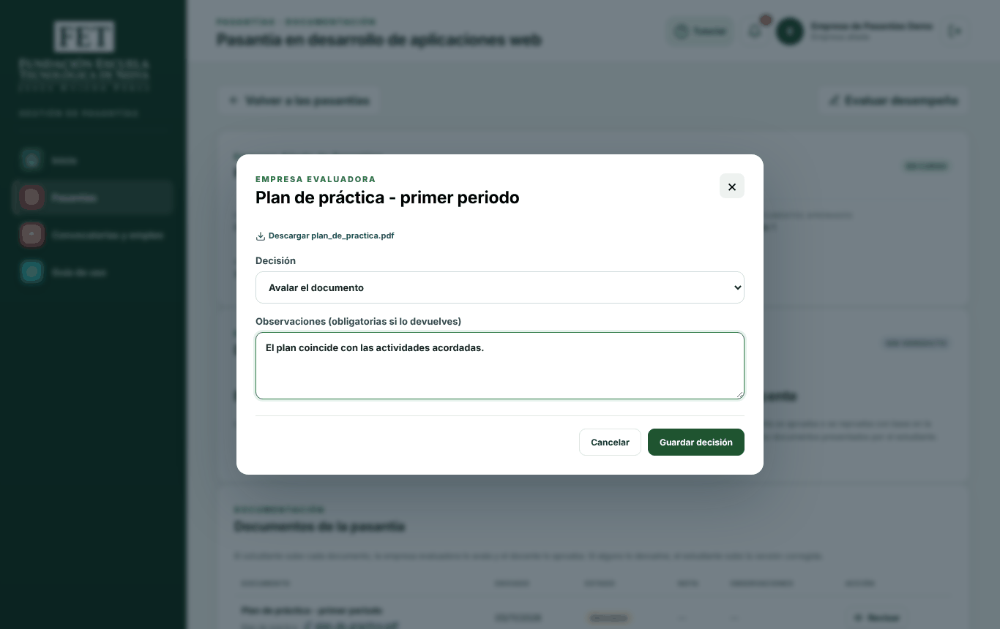

### Evaluación del desempeño del pasante

En el detalle de la pasantía, el botón *Evaluar desempeño*, o *Editar evaluación* si ya se registró, abre el formulario de la Figura 19. La empresa elige una calificación general de 1 a 5 y describe el desempeño del pasante en al menos 20 caracteres, considerando su responsabilidad, sus conocimientos, el trabajo en equipo y el cumplimiento. El docente tiene en cuenta esta evaluación para el veredicto, y la empresa puede editarla hasta que el veredicto se emita.

**Figura 19**

*Evaluación de desempeño del pasante*

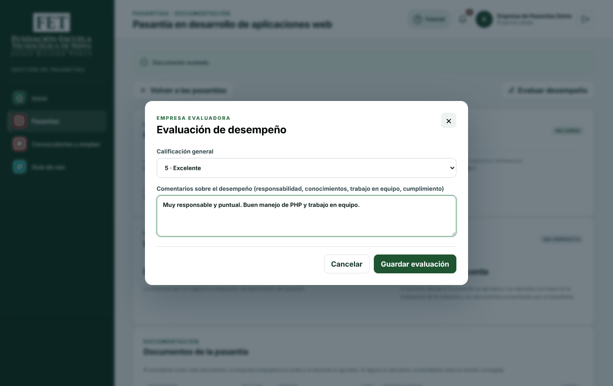

## Perfil de docente líder de pasantías

El docente líder revisa, audita, gestiona y aprueba las pasantías. Puede ver todas las pasantías, verifica las publicaciones de las empresas y consulta las alianzas y los reportes.

### Inicio

El inicio del docente muestra las pasantías en curso, los documentos que esperan calificación, las publicaciones por verificar y las pasantías que aún no tienen responsables (ver Figura 20).

**Figura 20**

*Inicio del docente líder*

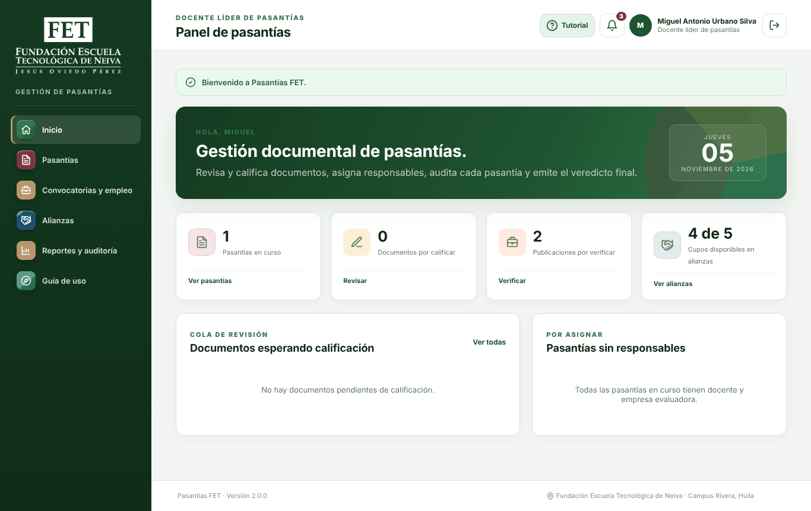

### Verificación de las publicaciones de las empresas

En *Convocatorias y empleo*, las publicaciones *En revisión* aparecen primero. Después de revisar su contenido, el docente pulsa *Verificar y publicar* para que los estudiantes puedan verla (ver Figura 21). Si prefiere devolverla a borrador o cerrarla, elige el estado y pulsa *Cambiar estado*. El docente también puede crear sus propias publicaciones con *Nueva publicación* y gestionar las postulaciones de la misma forma que una empresa.

**Figura 21**

*Verificación de una publicación*

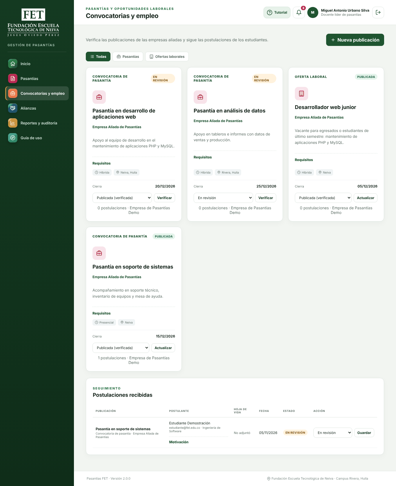

### Revisión de las pasantías

El módulo *Pasantías* presenta la lista completa, con el estudiante, la empresa evaluadora, el docente, los documentos aprobados y el estado de cada pasantía (ver Figura 22). Con *Registrar pasantía* se puede crear una pasantía de forma manual, por ejemplo cuando se gestionó por fuera de la plataforma.

**Figura 22**

*Pasantías vistas por el docente*

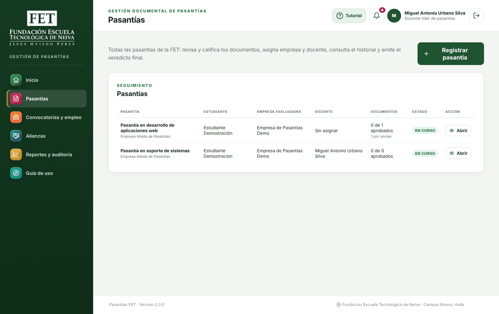

### Asignación de responsables

En el detalle de una pasantía, el botón *Asignar empresa y docente* permite definir la empresa evaluadora, el docente líder asignado, las fechas de inicio y fin y el estado (ver Figura 23). Antes de guardar, la plataforma comprueba que la empresa tenga cupo disponible.

**Figura 23**

*Asignación de empresa y docente*

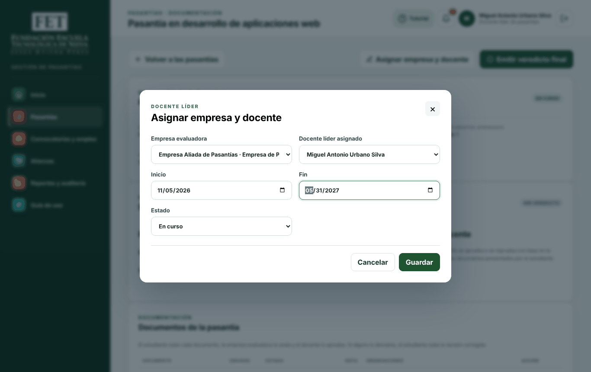

### Calificación de los documentos

En la tabla *Documentos de la pasantía*, el botón *Revisar* abre el diálogo de la Figura 24. El docente elige *Aprobar el documento* o *Devolver con observaciones*, escribe una calificación de 0.0 a 5.0 y sus observaciones, y pulsa *Guardar decisión*. Un documento se aprueba con 3.0 o más; con una nota menor debe devolverse. El estudiante ve la nota y las observaciones. No es necesario esperar el aval de la empresa para calificar.

**Figura 24**

*Calificación de un documento*

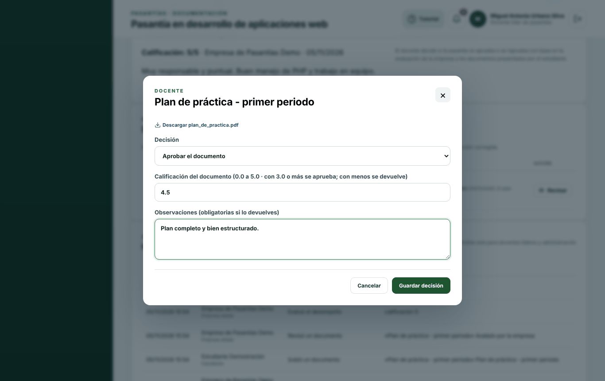

### Veredicto final

El veredicto se emite con el botón *Emitir veredicto final* del detalle de la pasantía. La plataforma sugiere el resultado según el promedio de notas, de modo que con 3.0 o más sugiere aprobar, y el docente escribe una justificación de al menos 20 caracteres que verá el estudiante (ver Figura 25). Al pulsar *Registrar veredicto* se pide una confirmación, porque el veredicto no puede cambiarse después.

**Figura 25**

*Registro del veredicto final*

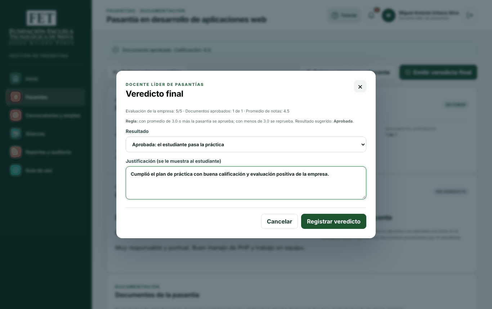

Una vez registrado el veredicto, la pasantía queda *Finalizada*, el cupo de la empresa se libera y el historial de la pasantía muestra todo lo ocurrido (ver Figura 26).

**Figura 26**

*Pasantía aprobada con su historial*

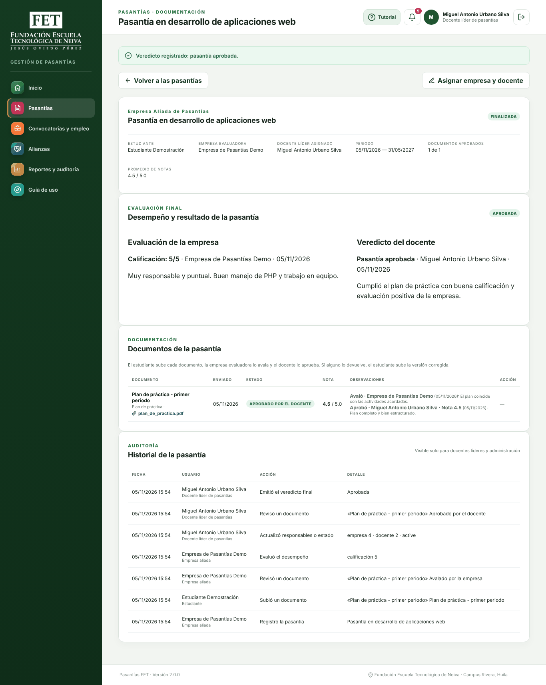

### Reportes y auditoría

En *Reportes y auditoría* se elige un periodo y se obtienen las cifras de pasantías, aprobadas y reprobadas, la nota promedio y los documentos pendientes; la ocupación de cupos y los resultados de cada empresa; el listado de pasantías del periodo con su resultado, y la bitácora de auditoría, que puede filtrarse por usuario (ver Figura 27). El reporte puede exportarse a un archivo CSV, que se abre en Excel, o imprimirse.

**Figura 27**

*Reportes y auditoría*

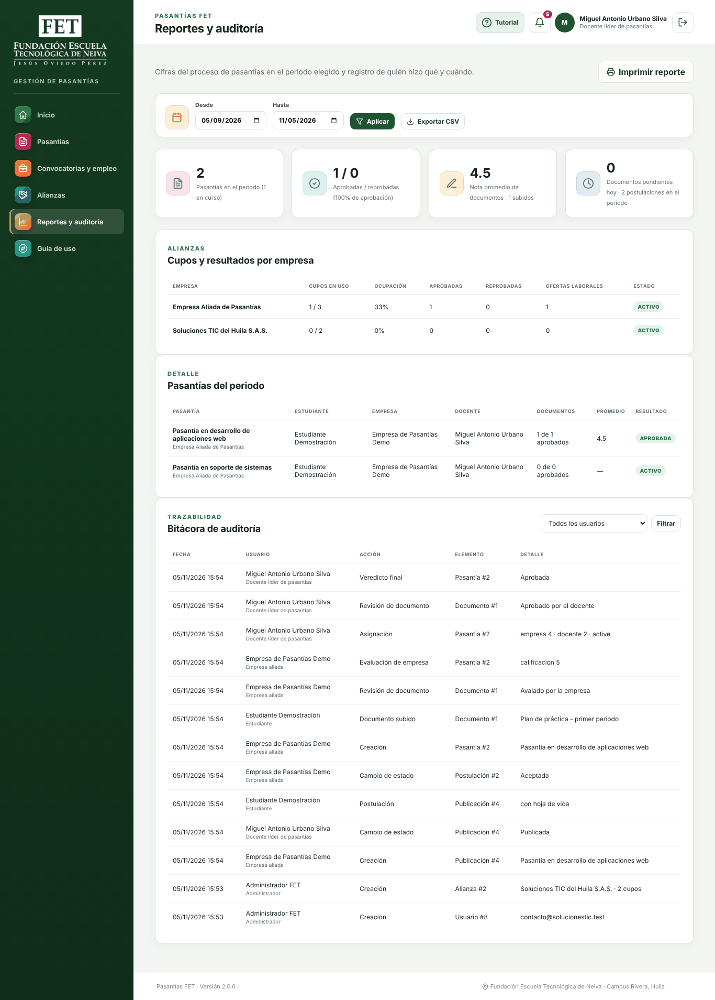

### Consulta de las alianzas

El docente puede consultar las alianzas y los cupos de cada empresa, pero no modificarlos (ver Figura 28).

**Figura 28**

*Alianzas en modo de consulta*

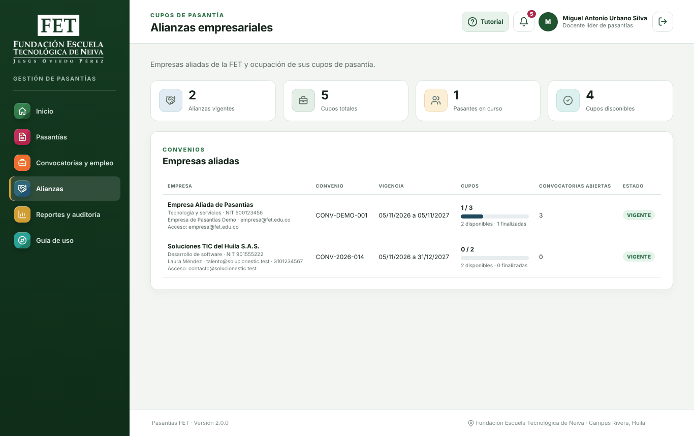

## Perfil de administrador

El administrador registra las alianzas empresariales y, con ellas, los cupos; administra las cuentas de usuario y cuenta con las mismas vistas de supervisión que el docente líder. Su inicio se muestra en la Figura 29.

**Figura 29**

*Inicio del administrador*

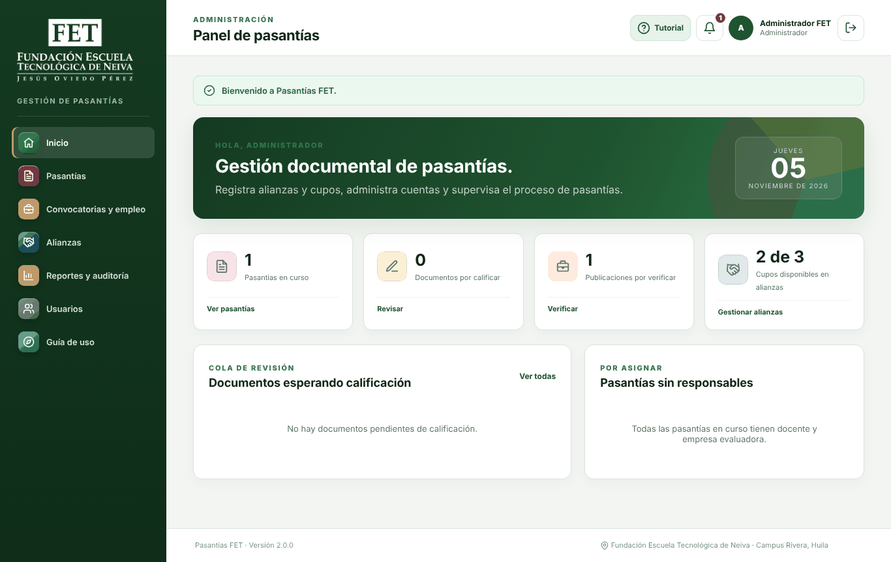

### Registro de una alianza empresarial

El módulo *Alianzas* presenta las empresas aliadas con su convenio, su vigencia, los cupos en uso y su estado (ver Figura 30).

**Figura 30**

*Listado de alianzas*

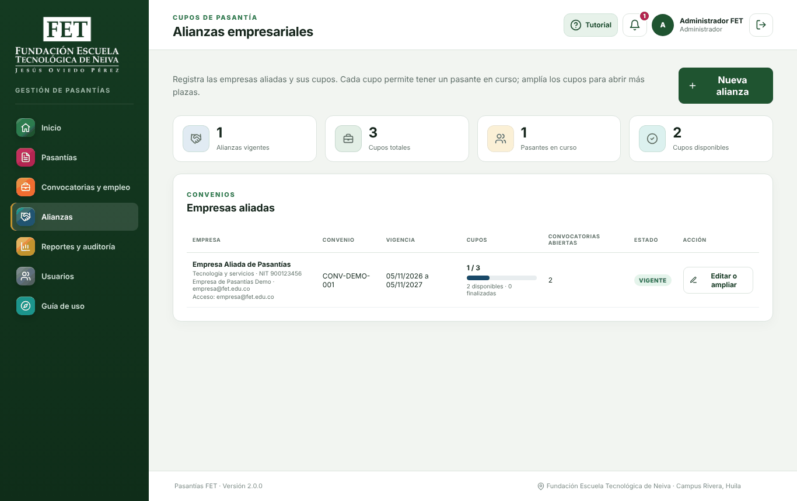

Para registrar una alianza se pulsa *Nueva alianza* (ver Figura 31). La primera parte del formulario recoge los datos de la empresa y del convenio: razón social, sector, código del convenio, número de cupos de pasantía, que corresponde a cuántos pasantes puede tener la empresa al mismo tiempo, fechas de inicio y fin de la vigencia y datos de contacto. La segunda parte define la cuenta de acceso de la empresa, que puede crearse con el NIT, un correo de acceso y una contraseña inicial de al menos 8 caracteres, o vincularse a una cuenta de empresa que ya exista. El registro termina con *Registrar alianza*.

**Figura 31**

*Formulario de registro de una alianza*

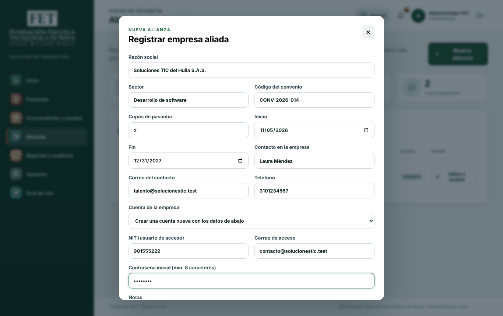

Desde ese momento la empresa puede entrar con su NIT o su correo y publicar convocatorias, y los docentes líderes reciben una notificación (ver Figura 32).

**Figura 32**

*Alianza registrada*

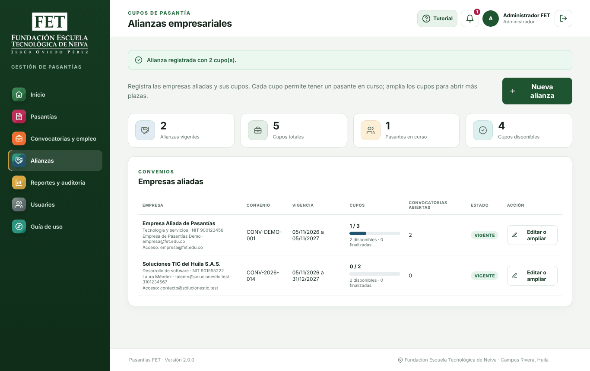

### Ampliación, suspensión o renovación de una alianza

El botón *Editar o ampliar* de cada alianza permite cambiar los cupos, que nunca pueden quedar por debajo de los pasantes activos; el estado (*Activa*, *Suspendida* o *Vencida*); las fechas y los datos de contacto (ver Figura 33). Una alianza suspendida o vencida no permite publicar convocatorias ni aceptar pasantes nuevos.

**Figura 33**

*Edición de una alianza*

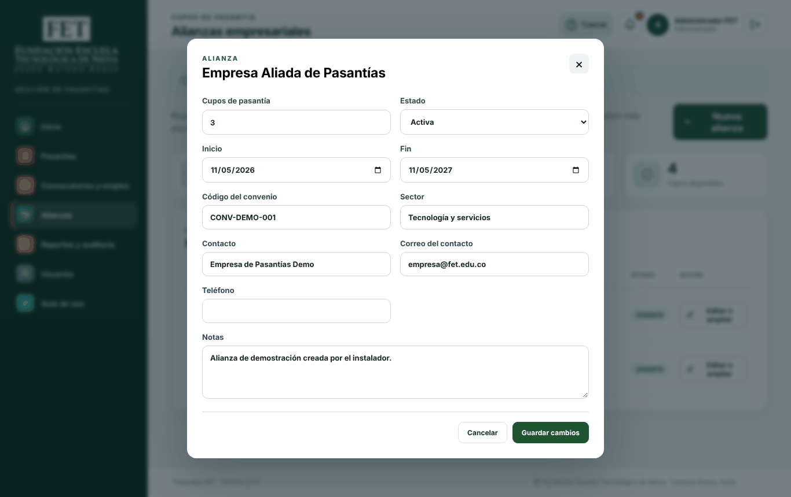

### Usuarios y permisos

El módulo *Usuarios* presenta todas las cuentas agrupadas por perfil (ver Figura 34). Desde allí el administrador crea cuentas de cualquier perfil con *Nuevo usuario* (ver Figura 35); en el caso de las empresas es preferible hacerlo desde *Alianzas*, para que la cuenta quede creada junto con sus cupos. También puede cambiar el perfil de una cuenta y guardarlo, desactivar o activar cuentas, asignar una contraseña nueva, lo que además desbloquea la cuenta, y desbloquear las cuentas bloqueadas por intentos fallidos. Por último, el botón *Descargar respaldo SQL* descarga una copia de la base de datos que termina con su huella SHA-256, con la que puede comprobarse que el archivo no se alteró.

**Figura 34**

*Listado de usuarios*

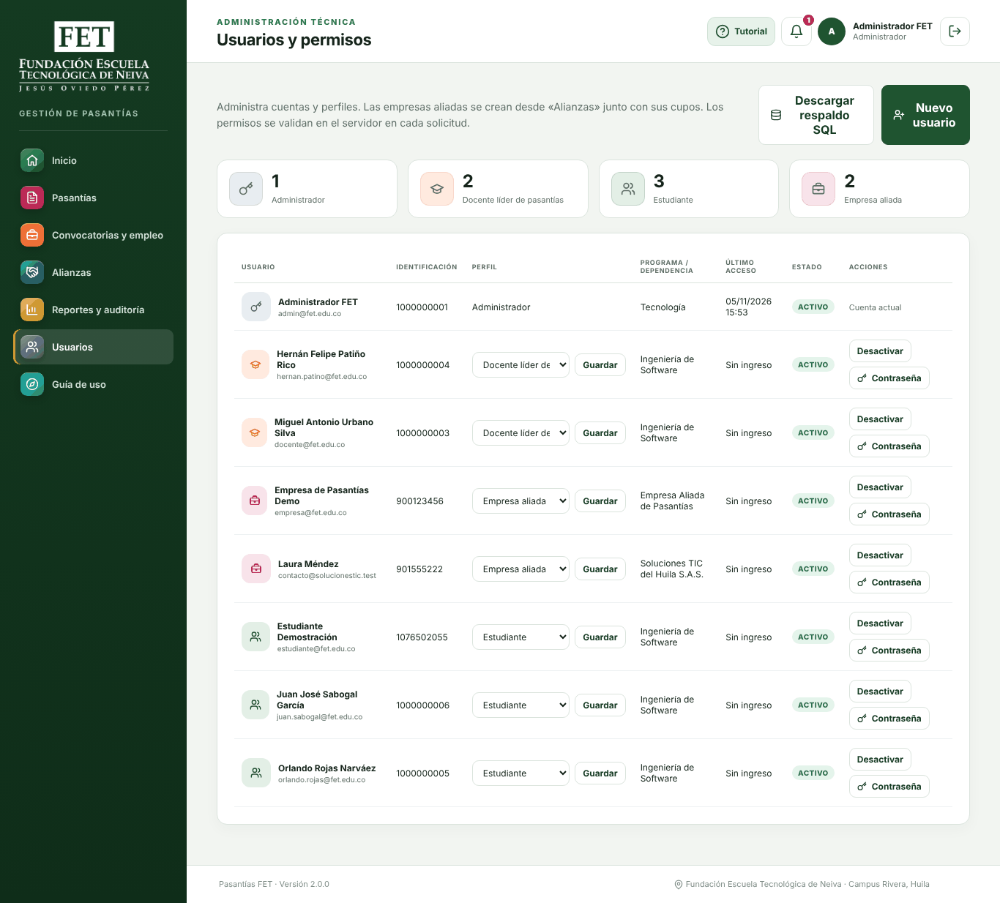

**Figura 35**

*Formulario de nuevo usuario*

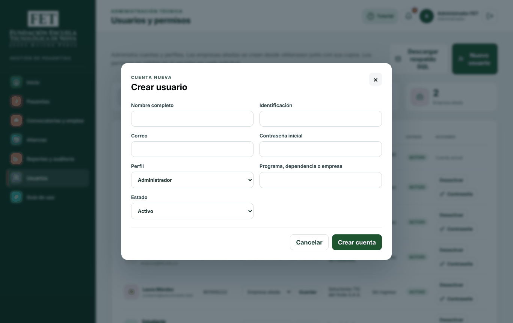

### Supervisión

El administrador tiene acceso a todas las pasantías, a la verificación de publicaciones en *Convocatorias y empleo* y a *Reportes y auditoría*, con las mismas funciones descritas para el docente líder (ver Figura 36).

**Figura 36**

*Reportes del administrador*

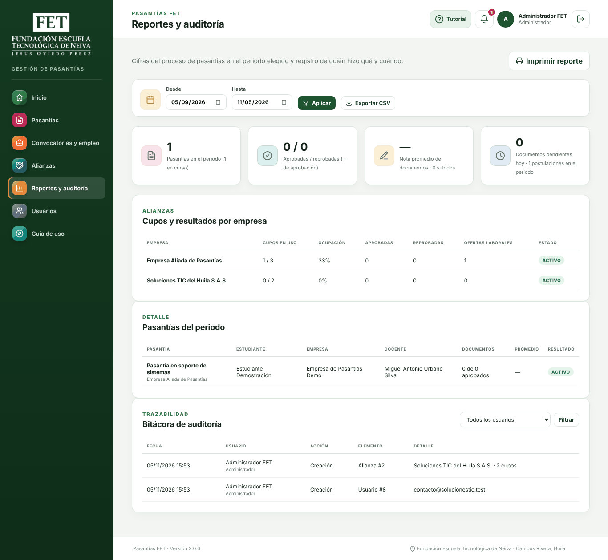

## Reglas del proceso

La plataforma aplica de forma automática las reglas de la Tabla 4. Conocerlas ayuda a entender por qué algunas acciones no están disponibles en ciertos momentos.

**Tabla 4**

*Reglas del proceso de pasantías*

| Regla | Detalle |
|---|---|
| Alianza obligatoria | Una empresa sin alianza vigente no puede publicar convocatorias ni aceptar pasantes |
| Cupos | Cada pasantía activa ocupa un cupo de la alianza, que se libera al finalizar la pasantía |
| Verificación | Las publicaciones de las empresas solo son visibles para los estudiantes después de que un docente líder o el administrador las verifica |
| Hoja de vida | Solo en PDF y de 5 MB como máximo; obligatoria en las ofertas laborales y opcional en las convocatorias de pasantía |
| Documentos | PDF, imagen u Office, de 5 MB como máximo; solo se descargan a través de la plataforma, que revisa los permisos |
| Nota de aprobación | Un documento se aprueba con 3.0 o más, en una escala de 0.0 a 5.0 |
| Veredicto | Solo lo emiten el docente líder o el administrador; para aprobar se necesita un promedio de 3.0 o más, y es irreversible |
| Auditoría | Toda acción importante queda en la bitácora con el usuario, la fecha y el detalle |

## Mensajes frecuentes del sistema

La plataforma confirma cada acción con un mensaje en verde y advierte los problemas con un mensaje en rojo. La Tabla 5 explica los avisos más comunes y qué hacer en cada caso.

**Tabla 5**

*Mensajes frecuentes y cómo resolverlos*

| Mensaje | Significado | Qué hacer |
|---|---|---|
| *Tu empresa necesita una alianza vigente con la FET para publicar.* | La empresa no tiene alianza, o está suspendida o vencida | Comunicarse con el administrador para registrarla o renovarla |
| *La alianza de la empresa no tiene cupos disponibles.* | Al aceptar o asignar un pasante no queda cupo libre | El administrador puede ampliar los cupos en *Alianzas* |
| *La empresa no tiene una alianza vigente con la FET.* | La alianza no existe, está suspendida o venció | El administrador debe registrarla o renovarla |
| *Adjunta tu hoja de vida en PDF para aplicar a la oferta laboral.* | Las ofertas laborales exigen hoja de vida | Adjuntar un PDF de 5 MB como máximo |
| *Explica tu interés en al menos 20 caracteres.* | La motivación de la postulación es muy corta | Explicar por qué interesa la convocatoria |
| *Ya te postulaste a esta convocatoria.* | Ya existe una postulación del estudiante | Consultar su estado en *Mis postulaciones* |
| *El archivo supera el límite de 5 MB.* | El archivo es demasiado grande | Comprimir el PDF o reducir las imágenes |
| *Con nota menor a 3.0 el documento no se aprueba: devuélvelo con observaciones.* | Se intentó aprobar con una nota baja | Elegir *Devolver con observaciones* |
| *Escribe la observación para que el estudiante sepa qué corregir.* | Se intentó devolver un documento sin observaciones | Escribir qué debe corregir el estudiante |
| *Para aprobar la pasantía, califica primero al menos un documento.* | Se intentó aprobar sin notas | Calificar los documentos antes del veredicto |
| *La pasantía ya tiene veredicto final.* | El veredicto es definitivo | No requiere acción |
| *La fecha de cierre no puede estar en el pasado.* | La fecha de cierre de la publicación no es válida | Elegir una fecha a partir de hoy |

## Preguntas frecuentes

Si un usuario no ve un módulo que sí ve un compañero, la razón suele ser el perfil: cada uno ve solo sus módulos, y el nombre y el perfil de la cuenta con la que se ingresó aparecen en la parte superior derecha. Cuando una empresa no puede aceptar a un estudiante, lo más probable es que su alianza no tenga cupos libres o no esté vigente; en ese caso el administrador puede ampliar los cupos o renovar la alianza.

Si la plataforma rechaza un archivo, hay que revisar su formato y su tamaño, que no puede superar 5 MB; la hoja de vida, además, debe estar en PDF. El veredicto final, en cambio, no puede corregirse dentro de la plataforma: es irreversible por diseño, para proteger la validez del resultado, y cualquier error debe tratarse con la coordinación de pasantías.

La plataforma también funciona desde el celular, donde el menú se abre con el botón de la parte superior. El recorrido de ayuda puede repetirse en cualquier momento con el botón *Tutorial*.

## Glosario

La Tabla 6 define los términos propios del proceso de pasantías que se usan en la plataforma y en este manual.

**Tabla 6**

*Glosario*

| Término | Significado |
|---|---|
| Alianza | Convenio entre la FET y una empresa, registrado en la plataforma con su vigencia y sus cupos |
| Cupo | Plaza para un pasante activo en una empresa aliada; cada pasantía en curso ocupa un cupo |
| Convocatoria de pasantía | Publicación de una empresa para recibir pasantes; usa los cupos de su alianza |
| Oferta laboral | Publicación opcional de empleo; no usa cupos y exige hoja de vida |
| Postulación | Solicitud de un estudiante a una convocatoria u oferta |
| Verificación | Revisión que hace la FET de una publicación antes de mostrarla a los estudiantes |
| Aval | Visto bueno de la empresa evaluadora sobre un documento del pasante |
| Calificación | Nota de 0.0 a 5.0 que el docente líder asigna a cada documento |
| Veredicto final | Decisión definitiva del docente: pasantía aprobada o reprobada |
| Bitácora de auditoría | Registro de quién hizo qué y cuándo dentro de la plataforma |

## Soporte

Las solicitudes de ayuda se dirigen según la Tabla 7. Además, la *Guía de uso* y el *Tutorial* de la plataforma resuelven la mayoría de las dudas sobre el uso de cada pantalla.

**Tabla 7**

*A quién acudir según la necesidad*

| Necesidad | Contacto |
|---|---|
| Obtener una cuenta, recuperar la contraseña o desbloquear la cuenta | Administrador de la plataforma, en la coordinación de pasantías |
| Registrar o ampliar la alianza de una empresa | Administrador de la plataforma |
| Resolver dudas sobre documentos, notas o el veredicto | Docente líder de pasantías |
| Reportar un error de la plataforma | Administrador de la plataforma, con una captura de pantalla, la fecha y la hora y los pasos seguidos |

## Documentación relacionada

**Tabla 8**

*Documentos que acompañan a este manual*

| Documento | Contenido |
|---|---|
| *Manual de despliegue de Pasantías FET 2.0.0* | Instalación, configuración, operación, respaldo y actualización del servidor |
| Repositorio del producto | Código fuente y registro de incidencias en https://github.com/OrlandoRojasNa/fet-pasantias |
