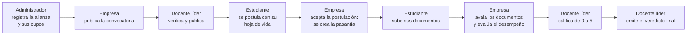

# Manual de usuario · Pasantías FET

Versión 2.0.0 · Fundación Escuela Tecnológica de Neiva · Campus Rivera, Huila

Pasantías FET es la plataforma que reúne en un solo lugar el proceso de pasantías de los estudiantes: las empresas aliadas publican convocatorias dentro de los cupos de su alianza, los estudiantes se postulan y suben los documentos de su pasantía, la empresa los avala y evalúa el desempeño, y el docente líder califica, audita y emite el veredicto final.

Este manual explica, perfil por perfil, qué puede hacer cada usuario y cómo hacerlo. Todas las capturas se tomaron con los datos de demostración que trae el instalador.

## Contenido

1. [Cómo entrar](#1-cómo-entrar)
2. [Elementos comunes de la pantalla](#2-elementos-comunes-de-la-pantalla)
3. [El proceso completo en una mirada](#3-el-proceso-completo-en-una-mirada)
4. [Perfil Estudiante](#4-perfil-estudiante)
5. [Perfil Empresa aliada](#5-perfil-empresa-aliada)
6. [Perfil Docente líder de pasantías](#6-perfil-docente-líder-de-pasantías)
7. [Perfil Administrador](#7-perfil-administrador)
8. [Reglas del proceso](#8-reglas-del-proceso)
9. [Preguntas frecuentes](#9-preguntas-frecuentes)

---

## 1. Cómo entrar

1. Abre el navegador (Chrome, Edge o Firefox) en `http://localhost/PruebaFet/` (o la dirección que te haya dado el administrador).
2. Escribe tu **número de identificación o tu correo** y tu **contraseña**.
3. Si estás en tu propio equipo, puedes marcar **Mantener mi sesión en este equipo**.
4. Pulsa **Ingresar**.

**Cuentas de demostración** (contraseña `FET2026*` en todas):

| Perfil | Correo |
|---|---|
| Administrador | admin@fet.edu.co |
| Docente líder de pasantías | docente@fet.edu.co |
| Estudiante | estudiante@fet.edu.co |
| Empresa aliada | empresa@fet.edu.co |

> **Seguridad:** después de **5 intentos fallidos** la cuenta se bloquea temporalmente. El administrador puede desbloquearla desde **Usuarios**. Si olvidaste la contraseña, usa **¿Olvidaste tu contraseña?**: el administrador recibe la solicitud y te asigna una nueva.

## 2. Elementos comunes de la pantalla

- **Menú lateral (izquierda):** muestra solo los módulos de tu perfil. Un estudiante ve *Inicio, Pasantías, Convocatorias y empleo* y *Guía de uso*; el docente y el administrador ven además *Alianzas* y *Reportes y auditoría*, y el administrador también *Usuarios*.
- **Tutorial:** recorre la pantalla actual paso a paso, explicada para tu perfil.
- **Campana:** tus notificaciones (postulaciones nuevas, documentos devueltos, veredicto, etc.). El número rojo indica cuántas no has leído.
- **Botón de salida** (flecha a la derecha de tu nombre): cierra la sesión.
- **Guía de uso:** resumen del flujo de trabajo de tu perfil y respuestas a dudas comunes.

## 3. El proceso completo en una mirada

Cada paso queda registrado en la **bitácora de auditoría** (quién hizo qué y cuándo) y genera notificaciones para las personas involucradas.

---

## 4. Perfil Estudiante

### 4.1 Inicio

Al entrar ves el estado de tu pasantía y accesos rápidos: convocatorias de pasantía abiertas, ofertas laborales abiertas, tus postulaciones en trámite y los documentos que debes corregir.

### 4.2 Buscar y postularse a una convocatoria u oferta laboral

1. Entra a **Convocatorias y empleo**. Usa las pestañas **Todas**, **Pasantías** u **Ofertas laborales** para filtrar.

   

2. En la tarjeta que te interese pulsa **Postularme** (pasantía) o **Aplicar con mi hoja de vida** (oferta laboral).
3. Escribe **¿Por qué te interesa?** y adjunta tu **hoja de vida en PDF** (máximo 5 MB).
   - En una **oferta laboral** la hoja de vida es **obligatoria**.
   - En una **convocatoria de pasantía** es **opcional**, pero recomendable.
4. Pulsa **Enviar postulación**.

   

5. La tarjeta queda marcada con **Ya te postulaste** y la postulación aparece en **Mis postulaciones**, con su estado (*Enviada, En revisión, Aceptada, No seleccionada*). Mientras no haya sido aceptada puedes **retirarla**.

   

### 4.3 Mi pasantía

Cuando la empresa **acepta** tu postulación a una pasantía, la plataforma crea tu pasantía automáticamente y te avisa por notificación.

1. Entra a **Pasantías** y pulsa **Abrir** en tu pasantía.

   

2. En el detalle ves la empresa evaluadora, el docente líder asignado, el periodo, los documentos aprobados y el promedio de notas.

   

### 4.4 Subir un documento

1. En el detalle de tu pasantía pulsa **Subir documento**.
2. Elige el **Tipo** (*Plan de práctica, Informe parcial, Informe final, Evaluación de la empresa, Certificado* u *Otro documento*), escribe un **Título** si quieres y selecciona el **Archivo** (PDF, imagen u Office; máximo 5 MB).
3. Pulsa **Enviar documento**.

   

4. El documento queda **Enviado**. Tu empresa evaluadora y tu docente reciben una notificación.

   

### 4.5 Corregir un documento devuelto

Si la empresa o el docente **devuelven** un documento, verás sus observaciones en la columna **Observaciones** y un botón **Corregir**. Púlsalo, adjunta el archivo corregido y explica qué cambiaste. La nota anterior se borra y el documento vuelve a revisión.

### 4.6 Consultar el resultado final

Cuando el docente emite el veredicto, la pasantía pasa a **Finalizada** y ves la **evaluación de la empresa**, el **veredicto del docente** (aprobada o reprobada) con su justificación, y la nota de cada documento.

### 4.7 Notificaciones

La campana y la página de notificaciones te muestran cada cambio: postulación aceptada, documento avalado, aprobado o devuelto, y veredicto final.

---

## 5. Perfil Empresa aliada

Una empresa solo puede publicar convocatorias de pasantía si tiene una **alianza vigente** con la FET. El administrador crea esa alianza y define cuántos **cupos** de pasantes tiene.

### 5.1 Inicio

Resume tus pasantes activos, tus convocatorias y las postulaciones recibidas.

### 5.2 Ver tu alianza y tus cupos

En **Convocatorias y empleo** aparece la franja de tu alianza: código del convenio, estado, **cupos en uso**, **cupos disponibles** y fecha de vigencia. Cada pasantía activa ocupa un cupo; al finalizar, el cupo se libera.

### 5.3 Publicar una convocatoria de pasantía u oferta laboral

1. Pulsa **Nueva publicación**.
2. Completa el formulario:
   - **Título** y **Tipo**: *Convocatoria de pasantía* (usa cupos de la alianza) u *Oferta laboral* (opcional, no usa cupos; el estudiante debe adjuntar hoja de vida).
   - **Modalidad** (presencial, híbrida o remota), **Ubicación** y **Fecha de cierre**.
   - **Descripción** y **Requisitos**.
   - **Publicación**: *Enviar a verificación de la FET* o *Guardar borrador*.
3. Pulsa **Guardar publicación**.

   

4. La publicación queda **En revisión**. Un docente líder o el administrador la verifica; cuando la publica, los estudiantes ya la ven. Puedes pasarla a **Borrador** o **Cerrada** cuando quieras con **Actualizar**.

### 5.4 Revisar postulaciones y aceptar pasantes

1. Baja hasta **Postulaciones recibidas**. Verás el estudiante, su motivación y el enlace a su **hoja de vida**.
2. Cambia el estado a **En revisión**, **Aceptada** o **No seleccionada** y pulsa **Guardar**.

   

3. Al **aceptar** una postulación a pasantía, la plataforma comprueba que tengas un cupo libre y **crea la pasantía** del estudiante, con tu empresa como evaluadora. Si no hay cupos, te lo indica y no la crea.

   

### 5.5 Avalar los documentos del pasante

1. En **Pasantías**, abre la pasantía y en la tabla de documentos pulsa **Revisar**.
2. Elige **Avalar el documento** o **Devolver con observaciones**, escribe tus observaciones (obligatorias si lo devuelves) y pulsa **Guardar decisión**.

   

### 5.6 Evaluar el desempeño del pasante

1. En el detalle de la pasantía pulsa **Evaluar desempeño** (o **Editar evaluación** si ya la registraste).
2. Elige la **Calificación general** de 1 a 5 y escribe los comentarios (responsabilidad, conocimientos, trabajo en equipo, cumplimiento; mínimo 20 caracteres).
3. Pulsa **Guardar evaluación**. El docente la tiene en cuenta para el veredicto; puedes editarla hasta que el docente emita el veredicto final.

   

---

## 6. Perfil Docente líder de pasantías

El docente líder revisa, audita, gestiona y aprueba las pasantías. Ve **todas** las pasantías, verifica las publicaciones de las empresas y consulta las alianzas y los reportes.

### 6.1 Inicio

Muestra las pasantías en curso, la **cola de documentos esperando calificación**, las **publicaciones por verificar** y las pasantías sin responsables.

### 6.2 Verificar las publicaciones de las empresas

1. Entra a **Convocatorias y empleo**. Las publicaciones **En revisión** aparecen primero.
2. Revisa el contenido. Si es correcto, elige **Publicada (verificada)** y pulsa **Verificar**. También puedes devolverla a borrador o cerrarla.

   

El docente también puede publicar convocatorias propias con **Nueva publicación** y gestionar postulaciones igual que una empresa.

### 6.3 Revisar las pasantías

En **Pasantías** ves la lista completa con estudiante, empresa evaluadora, docente, documentos aprobados y estado. Con **Registrar pasantía** puedes crear una manualmente (por ejemplo, una pasantía gestionada fuera de la plataforma).

### 6.4 Asignar responsables

En el detalle de una pasantía pulsa **Asignar empresa y docente** para definir la **empresa evaluadora**, el **docente líder asignado**, las fechas de **inicio** y **fin** y el **estado**. La plataforma comprueba que la empresa tenga cupo disponible.

### 6.5 Calificar los documentos

1. En la tabla **Documentos de la pasantía** pulsa **Revisar**.
2. Elige **Aprobar el documento** o **Devolver con observaciones**.
3. Escribe la **Calificación** de 0.0 a 5.0 (con 3.0 o más se aprueba; con menos se devuelve) y tus observaciones.
4. Pulsa **Guardar decisión**. El estudiante ve la nota y las observaciones.

   

> No es obligatorio esperar el aval de la empresa para calificar.

### 6.6 Emitir el veredicto final

1. En el detalle de la pasantía pulsa **Emitir veredicto final**.
2. La plataforma sugiere el resultado según el **promedio de notas** (3.0 o más: aprobada). Escribe la **Justificación**, que verá el estudiante (mínimo 20 caracteres).
3. Pulsa **Registrar veredicto** y confirma. **El veredicto no se puede cambiar después.**

   

4. La pasantía queda **Finalizada**, el cupo de la empresa se libera y el **Historial de la pasantía** muestra todo lo ocurrido.

   

### 6.7 Reportes y auditoría

En **Reportes y auditoría** eliges un periodo y ves:

- Pasantías del periodo, aprobadas/reprobadas, nota promedio y documentos pendientes.
- **Cupos y resultados por empresa** (ocupación de cada alianza).
- **Pasantías del periodo** con su resultado.
- **Bitácora de auditoría**, filtrable por usuario.

Puedes **Exportar CSV** (se abre en Excel) o **Imprimir reporte**.

### 6.8 Consultar las alianzas

El docente ve las alianzas y los cupos de cada empresa en modo de solo lectura.

---

## 7. Perfil Administrador

El administrador crea las alianzas empresariales (y con ellas los cupos), administra las cuentas y tiene las mismas vistas de supervisión que el docente.

### 7.1 Inicio

### 7.2 Registrar una alianza empresarial

1. Entra a **Alianzas**. Verás las empresas aliadas, su convenio, vigencia, cupos en uso y estado.

   

2. Pulsa **Nueva alianza** y completa:
   - **Razón social**, **Sector** y **Código del convenio**.
   - **Cupos de pasantía**: cuántos pasantes puede tener la empresa al mismo tiempo.
   - **Inicio** y **Fin** de la vigencia.
   - Datos de **contacto**.
   - **Cuenta de la empresa**: crea una cuenta nueva (con **NIT**, **correo de acceso** y **contraseña inicial** de mínimo 8 caracteres) o vincula una cuenta de empresa que ya exista.
3. Pulsa **Registrar alianza**.

   

4. La empresa ya puede entrar con su NIT o correo y publicar convocatorias. Los docentes líderes reciben una notificación.

   

### 7.3 Ampliar cupos, suspender o renovar una alianza

Pulsa **Editar o ampliar** en la alianza. Puedes cambiar los **cupos** (nunca por debajo de los pasantes activos), el **estado** (*Activo, Suspendida* o *Vencida*), las fechas y el contacto. Una alianza suspendida o vencida no permite publicar ni aceptar pasantes nuevos.

### 7.4 Usuarios y permisos

En **Usuarios** ves todas las cuentas por perfil. Desde aquí puedes:

- **Nuevo usuario**: crear cuentas de cualquier perfil. Para las empresas es mejor usar *Alianzas*, porque así la cuenta queda creada junto con sus cupos.
- Cambiar el **perfil** de una cuenta y pulsar **Guardar**.
- **Desactivar** o activar una cuenta.
- **Contraseña**: asignar una contraseña nueva (también desbloquea la cuenta).
- **Desbloquear** una cuenta bloqueada por intentos fallidos.
- **Descargar respaldo SQL** de la base de datos (con su huella SHA-256 para verificar que no se alteró).

### 7.5 Supervisión

El administrador también tiene **Pasantías** (todas), **Convocatorias y empleo** (verificación) y **Reportes y auditoría**, con las mismas funciones descritas para el docente líder.

---

## 8. Reglas del proceso

| Regla | Detalle |
|---|---|
| Alianza obligatoria | Una empresa sin alianza vigente no puede publicar convocatorias ni aceptar pasantes. |
| Cupos | Cada pasantía activa ocupa un cupo de la alianza. Al finalizar la pasantía, el cupo se libera. |
| Verificación | Las publicaciones de las empresas solo son visibles para los estudiantes después de que un docente líder o el administrador las verifica. |
| Hoja de vida | Solo PDF, máximo 5 MB. Obligatoria en ofertas laborales y opcional en convocatorias de pasantía. |
| Documentos | PDF, imagen u Office, máximo 5 MB. Se descargan solo a través de la plataforma, que revisa los permisos. |
| Nota de aprobación | Un documento se aprueba con 3.0 o más (escala 0.0 a 5.0). |
| Veredicto | Solo el docente líder o el administrador lo emiten. Para *aprobada* se necesita un promedio de 3.0 o más. Es irreversible. |
| Auditoría | Toda acción importante queda en la bitácora con usuario, fecha y detalle. |

## 9. Preguntas frecuentes

**No veo un módulo que sí ve mi compañero.** Cada perfil ve solo sus módulos. Revisa con qué cuenta entraste (tu nombre y perfil aparecen arriba a la derecha).

**La empresa no puede aceptar a un estudiante.** Probablemente la alianza no tiene cupos libres o no está vigente. El administrador puede ampliar los cupos o renovar la alianza en *Alianzas*.

**Subí un archivo y me dice que no está permitido.** Revisa el formato y el tamaño (máximo 5 MB). La hoja de vida debe ser PDF.

**Me equivoqué en el veredicto.** El veredicto es irreversible por diseño. El caso debe gestionarse con el administrador por fuera de la plataforma.

**¿Cómo vuelvo a ver el recorrido de ayuda?** Pulsa **Tutorial** en la parte superior de cualquier pantalla.

---

*Las capturas de este manual se generan automáticamente con `node docs/manual/generar_capturas.js docs/manual/img http://localhost/PruebaFet` sobre una base recién instalada (ver el [manual de despliegue](../MANUAL_DESPLIEGUE.md)).*
