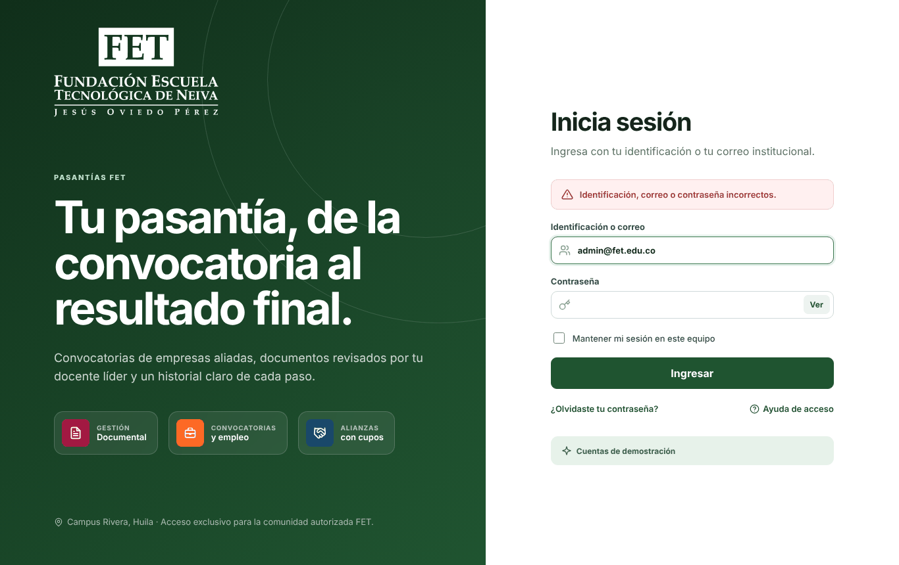
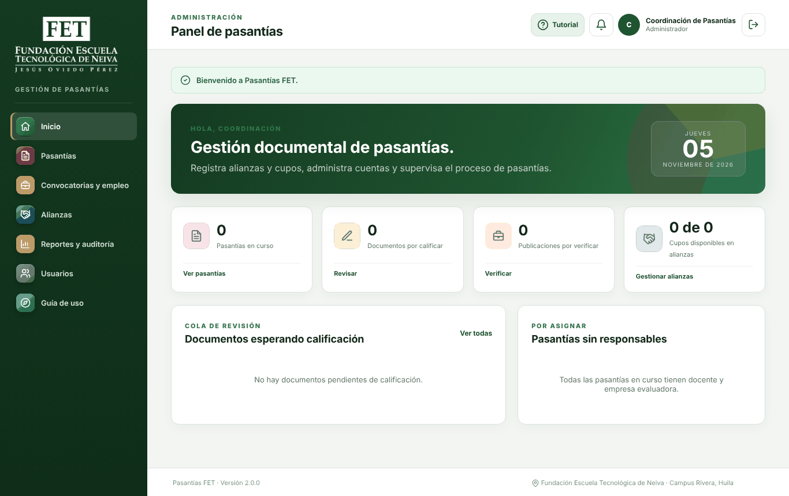
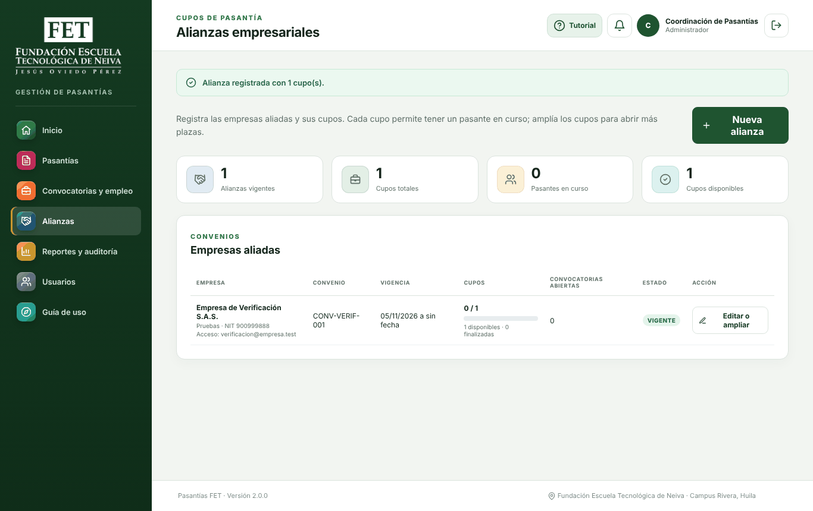
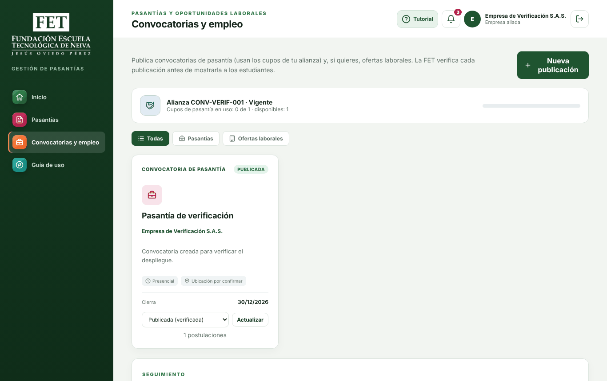
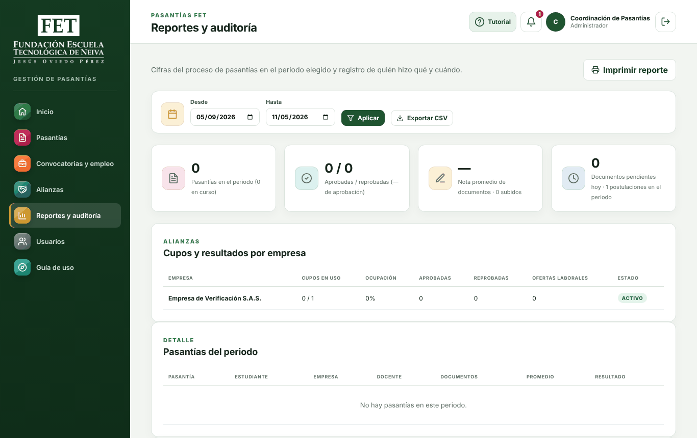

# Prueba de despliegue de Pasantías FET 2.0.0 en máquinas virtuales Ubuntu Server

Este informe presenta los resultados de la prueba de despliegue de Pasantías FET 2.0.0, la plataforma de gestión documental de pasantías de la Fundación Escuela Tecnológica de Neiva. El objetivo fue comprobar que el procedimiento descrito en el *Manual de despliegue* (Rojas Narváez et al., 2026) funciona tal como está escrito cuando se aplica sobre servidores sin ninguna configuración previa, y corregir los problemas que impidieran o pusieran en riesgo una instalación en producción.

La prueba se realizó el 5 de noviembre de 2026. Como resultado, la plataforma quedó publicada con HTTPS y cumplió los ocho puntos de la verificación posterior al despliegue. Durante el proceso se identificaron cinco problemas, que se corrigieron en el código fuente o en el manual antes de repetir la instalación en un servidor nuevo.

## Método

### Ambiente de prueba

Se emplearon tres servidores con Ubuntu Server 24.04.5 LTS creados para la prueba (Canonical, 2024). Cada servidor se ejecutó como un contenedor de sistema aislado, sin paquetes adicionales instalados, lo que reproduce las condiciones de una máquina virtual recién creada. Las características del ambiente se resumen en la Tabla 1.

**Tabla 1**

*Características del ambiente de prueba*

| Elemento | Valor |
|---|---|
| Sistema operativo | Ubuntu Server 24.04.5 LTS |
| Software instalado por el procedimiento | Apache 2.4.58, PHP 8.3.6, MariaDB 10.11.14 y Git |
| Dominio | `pasantias.fet.edu.co`, resuelto de forma local hacia la dirección IP del servidor |
| Certificado | Autofirmado, porque el dominio no es público y Let's Encrypt no puede validarlo |
| Versión desplegada | Rama `docs-manuales-pruebas` del repositorio, que contiene los cambios de lanzamiento |

### Procedimiento

Cada servidor tuvo un propósito distinto (ver Tabla 2). En el primero se siguió el manual comando por comando, en las secciones 5.1 a 5.9, y se probaron el respaldo y la restauración descritos en la sección 9. En el segundo se ejecutó por primera vez el instalador automático `deploy/instalar_servidor.sh`, incluida una segunda ejecución sobre la instalación existente. El tercero se reservó para la prueba final del instalador ya corregido y para la verificación completa de la sección 7 del manual.

**Tabla 2**

*Uso de cada servidor en la prueba*

| Servidor | Uso |
|---|---|
| VM 1 | Instalación manual (secciones 5.1 a 5.9) y prueba de respaldo y restauración (sección 9) |
| VM 2 | Primera ejecución del instalador automático y de su ejecución repetida |
| VM 3 | Instalación final con el instalador corregido y verificación posterior al despliegue (sección 7) |

## Resultados

### Instalación manual

La Tabla 3 muestra el resultado de cada paso de la instalación manual. Todos los pasos se completaron, salvo la configuración del cortafuegos `ufw`, que no pudo aplicarse porque el aislamiento del contenedor no permite modificar las reglas de red del sistema. En un servidor o una máquina virtual convencional ese paso se aplica como lo indica el manual.

**Tabla 3**

*Resultado de la instalación manual en la VM 1*

| Sección | Paso | Resultado |
|---|---|---|
| 5.1 | Instalar Apache, MariaDB, Git, PHP y sus extensiones; activar `rewrite` y `headers` | Completado (PHP 8.3.6) |
| 5.2 | Crear la base de datos `fet_intranet` y el usuario `pasantias` | Completado |
| 5.3 | Clonar el repositorio en `/var/www/pasantias-fet` | Completado |
| 5.4 | Crear el archivo `.env` de producción y aplicar permisos | Completado |
| 5.5 | Ejecutar `install.php --produccion` con el administrador inicial | Completado |
| 5.6 | Configurar el VirtualHost con cabeceras de seguridad | Completado (`Syntax OK`) |
| 5.7 | Configurar HTTPS con certificado autofirmado y redirección desde HTTP | Completado; el procedimiento se agregó al manual |
| 5.8 | Ajustar `php.ini` para producción | Completado |
| 5.9 | Activar el cortafuegos `ufw` | No aplicable en el contenedor |
| 9.1 | Programar el respaldo diario | Completado; se generan `base-AAAA-MM-DD.sql.gz` y `documentos-AAAA-MM-DD.tar.gz` |
| 9.2 | Restaurar un respaldo después de borrar un usuario | Completado; el usuario se recuperó y el sitio respondió con código 200 |
| 10.1 | Ejecutar de nuevo el instalador sobre la base existente | Completado, sin registros duplicados |

### Verificación posterior al despliegue

En la VM 3 se aplicó la lista de verificación de la sección 7 del manual. Los ocho puntos se cumplieron (ver Tabla 4). Los archivos internos de la aplicación, como `.env`, `config/database.php` o la carpeta `.git`, respondieron con el código 403. Las cuentas de demostración no existen en la base de producción.

**Tabla 4**

*Resultado de la verificación posterior al despliegue en la VM 3*

| N.º | Verificación | Resultado obtenido |
|---|---|---|
| 1 | Abrir `https://pasantias.fet.edu.co/` | Código 200 y pantalla de acceso |
| 2 | Abrir `http://pasantias.fet.edu.co/` | Redirección 301 hacia la dirección con HTTPS |
| 3 | Entrar con el administrador inicial | Se abre el panel de pasantías |
| 4 | Solicitar `/.env`, `/config/database.php`, `/database/install.php`, `/storage/`, `/storage/documents/`, `/tests/smoke_test.php` y `/.git/config` | Código 403 en todas las rutas |
| 5 | Entrar con la cuenta de demostración `admin@fet.edu.co` | Acceso rechazado |
| 6 | Descargar el respaldo SQL desde *Usuarios* | Archivo de 13,4 KB con su huella SHA-256 |
| 7 | Crear una alianza, subir un PDF y descargarlo | El documento se subió y se descargó íntegro; sin sesión, la descarga redirige al acceso |
| 8 | Revisar errores de PHP en el registro de Apache | Ningún error registrado |

Para comprobar el funcionamiento en condiciones reales se recorrió además el proceso completo de una pasantía. El administrador registró la alianza *Empresa de Verificación S.A.S.* con un cupo y creó un estudiante. La empresa publicó una convocatoria, el administrador la verificó y el estudiante se postuló con su hoja de vida, que la empresa descargó. Al terminar, la alianza de prueba se suspendió.

También se comprobaron otros controles de seguridad. La cookie de sesión se envía con los atributos `secure`, `HttpOnly` y `SameSite=Lax`, y las respuestas incluyen las cabeceras `X-Content-Type-Options`, `X-Frame-Options` y `Referrer-Policy`. Los archivos subidos quedan con permisos `640`, de modo que solo el servidor web puede leerlos, y los respaldos con permisos `600`, accesibles solo para el administrador del sistema. El respaldo diario quedó programado en `/etc/cron.d/respaldo-pasantias`, y después de ejecutar el instalador dos veces la base conservó un único administrador.

### Problemas encontrados y corregidos

Durante la prueba se identificaron cinco problemas. La Tabla 5 resume cada uno, su impacto y la corrección aplicada. Después de las correcciones se repitió la instalación completa en la VM 3, con resultado satisfactorio, y las pruebas automáticas del ambiente de pruebas (`tests/smoke_test.php`) se mantuvieron en ocho de ocho flujos aprobados.

**Tabla 5**

*Problemas encontrados durante la prueba de despliegue*

| ID | Problema | Impacto | Corrección |
|---|---|---|---|
| H-01 | Los archivos subidos quedaban con permisos `666`, legibles y modificables por cualquier usuario del servidor | Seguridad, alto | Cada archivo queda con permisos `640` y su carpeta con `750` |
| H-02 | La pantalla de acceso mostraba las cuentas de demostración y su contraseña también en producción | Seguridad, medio | El recuadro solo aparece cuando `APP_ENV` es distinto de `production`; el archivo `.env` se carga al inicio de cada página |
| H-03 | Después de aplicar los permisos de producción, `git checkout` no permitía actualizar el código | Operación, alto | Se agregó `git config core.fileMode false` al manual y al instalador |
| H-04 | Los respaldos quedaban con permisos amplios cuando la máscara del sistema es permisiva | Seguridad, medio | El script de respaldo usa `umask 077` |
| H-05 | El manual solo describía HTTPS con Let's Encrypt, y el instalador fallaba en servidores sin `sudo` | Despliegue, medio | Se documentó el procedimiento con certificado propio o autofirmado; el instalador instala `sudo` y `cron` si faltan |

### Evidencias

Las figuras 1 a 5 corresponden a capturas de pantalla tomadas en el servidor de producción durante la verificación.

**Figura 1**

*Acceso rechazado para la cuenta de demostración en producción*



**Figura 2**

*Panel del administrador inicial con la base de producción vacía*



**Figura 3**

*Alianza registrada en producción*



**Figura 4**

*Postulación recibida por la empresa con la hoja de vida subida al servidor*



**Figura 5**

*Bitácora de auditoría con el recorrido de la prueba*



## Conclusiones

El procedimiento del manual permite instalar Pasantías FET 2.0.0 en un servidor Ubuntu Server 24.04 sin configuración previa, tanto de forma manual como con el instalador automático. La prueba permitió detectar dos problemas de seguridad que no se habrían visto en el ambiente de desarrollo, el de los permisos de los archivos subidos y el de las cuentas de demostración visibles en producción, además de un problema de operación que habría impedido las actualizaciones futuras. Los tres quedaron resueltos antes de la entrega.

La prueba puede repetirse en una máquina virtual con Ubuntu Server 22.04 o 24.04, según la sección 5.10 del manual, con los siguientes comandos:

```bash
sudo apt install -y git
git clone https://github.com/OrlandoRojasNa/fet-pasantias.git ~/fet-pasantias && cd ~/fet-pasantias
sudo DOMINIO=pasantias.local ADMIN_CORREO=coordinacion.pasantias@fet.edu.co \
     ADMIN_ID=1075000000 ADMIN_CLAVE='ClaveSegura2026' bash deploy/instalar_servidor.sh
```

## Referencias

Canonical. (2024). *Ubuntu Server 24.04 LTS* [Sistema operativo]. https://ubuntu.com/server

Rojas Narváez, O., Patiño Rico, H. F., & Sabogal García, J. J. (2026). *Manual de despliegue: Pasantías FET versión 2.0.0* [Manual técnico]. Fundación Escuela Tecnológica de Neiva. https://github.com/OrlandoRojasNa/fet-pasantias/blob/main/docs/MANUAL_DESPLIEGUE.md
