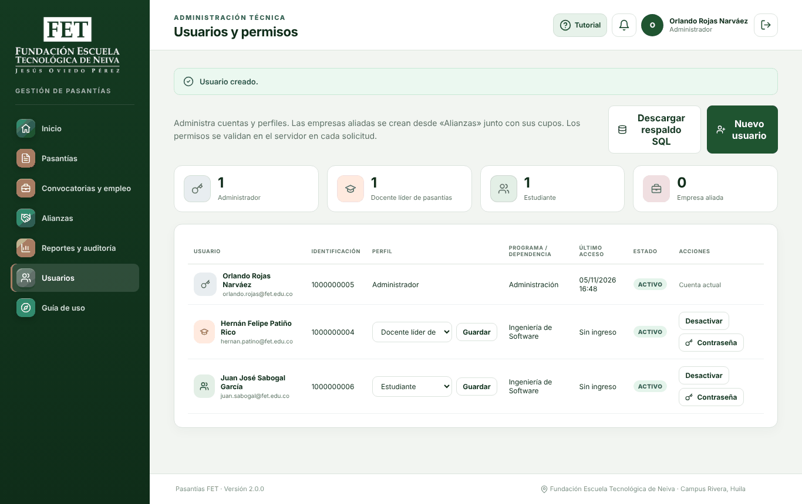
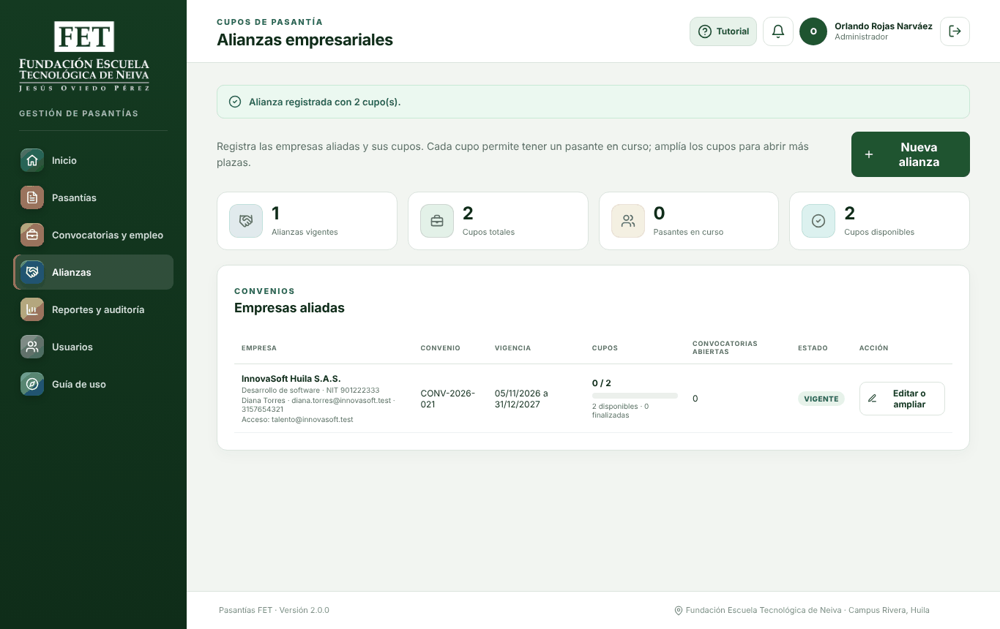
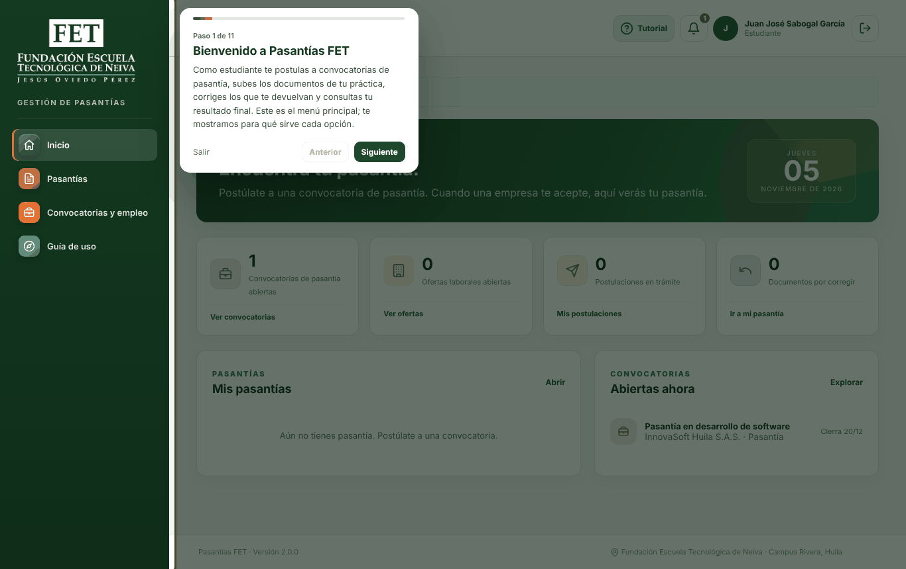
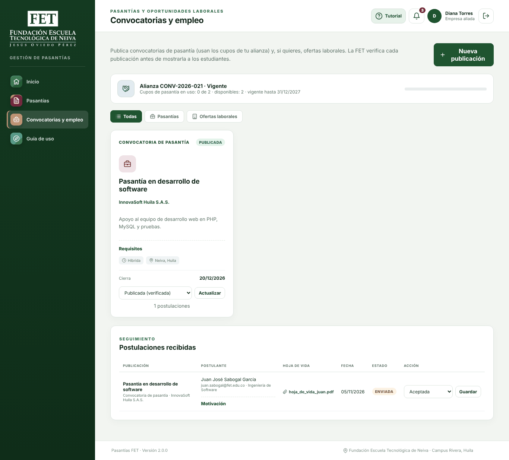
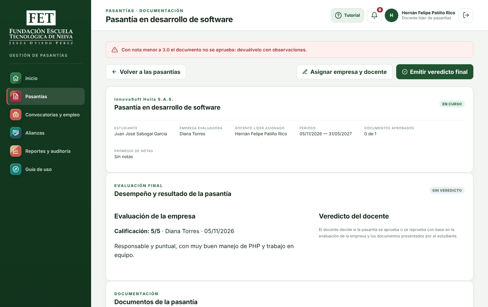
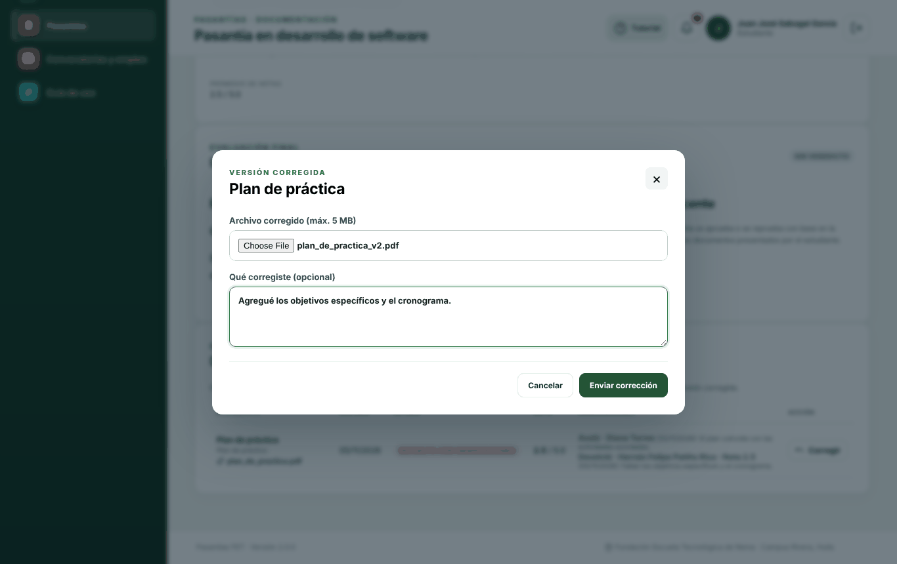
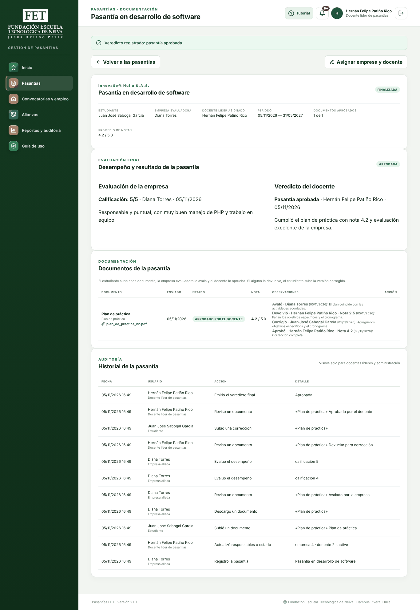
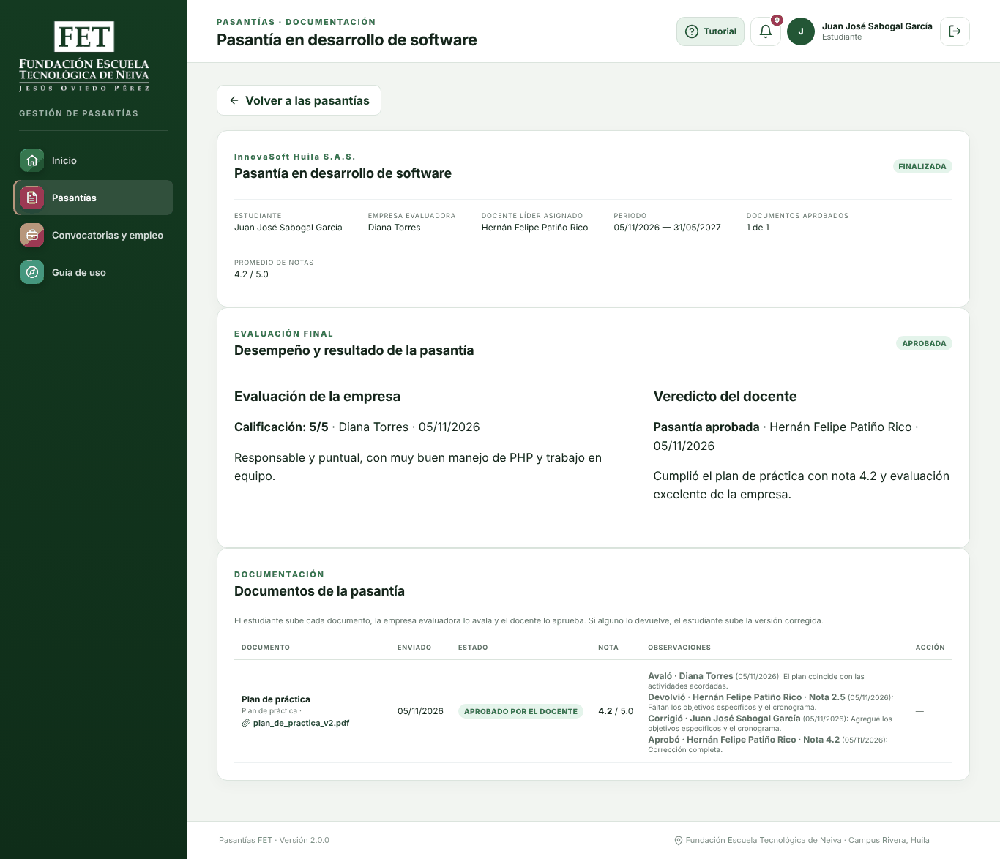
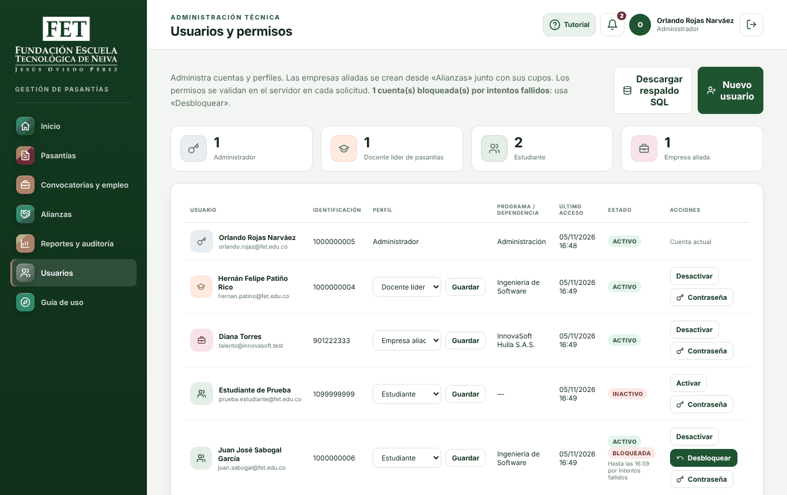

# Resultados · Ejecución de los guiones de prueba en el servidor de producción

| | |
|---|---|
| **Producto** | Pasantías FET 2.0.0 |
| **Fecha** | 05/11/2026 |
| **Servidor** | Máquina virtual Ubuntu Server 24.04.5 LTS instalada con `deploy/instalar_servidor.sh` (Apache 2.4.58, PHP 8.3.6, MariaDB 10.11.14, HTTPS). Es la VM 3 del [informe de despliegue](../pruebas-despliegue/INFORME_DESPLIEGUE.md). |
| **Base de datos** | Producción recién instalada: sin datos de demostración y con un único administrador inicial |
| **Cómo se ejecutó** | Se automatizaron los cuatro guiones con un navegador controlado por un programa (Chromium con Playwright). Se usó una sesión independiente por perfil y se siguió el orden de la sesión del [plan de pruebas](README.md). |
| **Resultado** | ✅ **25 de 25 pasos completados** en la corrida final, sin errores de JavaScript en ninguna pantalla. En la primera corrida aparecieron **2 errores reales de la plataforma**; los dos quedaron corregidos. |

> **Importante.** Esta ejecución comprueba que cada tarea de los guiones **se puede completar** en producción y que la plataforma responde como dicen los manuales. No reemplaza la sesión con los integrantes del equipo. El tiempo de una persona, la dificultad percibida, las observaciones y el cuestionario de satisfacción (SUS) solo los pueden dar Juan José, Hernán y Orlando. Por eso esos campos siguen en blanco en los guiones y en el [formato de resultados](formato-resultados.md).

## 1. Cuentas usadas

En producción no existen las cuentas de demostración ni la clave `FET2026*`. Por eso la sesión empezó con la puesta en marcha de la sección 8 del manual de despliegue, que en los guiones aparece como paso P0.

| Perfil | Cuenta | Cómo se creó |
|---|---|---|
| Administrador | orlando.rojas@fet.edu.co | Administrador inicial, creado por el instalador |
| Docente líder | hernan.patino@fet.edu.co | Creada por el administrador en **Usuarios** (P0) |
| Estudiante | juan.sabogal@fet.edu.co | Creada por el administrador en **Usuarios** (P0) |
| Empresa | NIT 901222333 · *InnovaSoft Huila S.A.S.* | Creada por el administrador al registrar la alianza (A1) |

Las contraseñas fueron de prueba y solo existieron en la máquina virtual. Al terminar, la base se borró.

## 2. Resultado por tarea

✅ completó · ❌ no completó. El paso es el turno dentro de la sesión del [plan de pruebas](README.md).

| Paso | Código | Perfil | Tarea | Qué se comprobó | Resultado |
|---|---|---|---|---|---|
| 0 | P0 | Administrador | Crear las cuentas de Hernán y Juan José | Las dos cuentas quedan creadas | ✅ |
| 1 | A1 | Administrador | Registrar una alianza con una empresa nueva | «Alianza registrada con 2 cupo(s)»; aparece *Vigente* con 0 / 2 cupos | ✅ |
| 2 | E1 | Empresa | Entrar y revisar la alianza | Entra con el NIT; ve la franja *Cupos en uso: 0 de 2* y la vigencia | ✅ |
| 2 | E2 | Empresa | Publicar una convocatoria de pasantía | Queda *En revisión* («enviada a la FET para su verificación») | ✅ |
| 3 | D1 | Docente | Revisar el panel | Ve 1 publicación por verificar y la notificación | ✅ |
| 3 | D2 | Docente | Verificar la convocatoria | Queda *Publicada* | ✅ |
| 4 | S1 | Estudiante | Entrar y ubicarse | Ve 1 convocatoria abierta; el tutorial se abre solo la primera vez y el botón **Tutorial** lo vuelve a abrir | ✅ (después de corregir F-01) |
| 4 | S2 | Estudiante | Postularse con hoja de vida | «Tu postulación quedó registrada»; la tarjeta dice *Ya te postulaste* | ✅ |
| 5 | E3 | Empresa | Aceptar al estudiante | Descarga la hoja de vida en PDF; se crea la pasantía; la alianza pasa a 1 de 2 cupos | ✅ |
| 6 | D3 | Docente | Asignarse a la pasantía | La pasantía aparece sin responsables; queda Hernán como docente líder | ✅ |
| 7 | S3 | Estudiante | Subir el plan de práctica | Documento en estado *Enviado* | ✅ |
| 8 | E4 | Empresa | Avalar el plan de práctica | Descarga el documento y lo avala | ✅ |
| 8 | E5 | Empresa | Evaluar el desempeño | Guarda 4/5 y luego la edita a 5/5 | ✅ |
| 9 | D4 | Docente | Devolver el documento con nota baja | No deja **aprobar** con 2.5; lo **devuelve** con 2.5 y la observación | ✅ (después de corregir F-02) |
| 10 | S4 | Estudiante | Corregir el documento devuelto | Ve la observación y la nota; envía la versión corregida; la nota anterior desaparece | ✅ |
| 11 | D5 | Docente | Aprobar la corrección | Aprobado con 4.2; promedio 4.2 / 5.0 | ✅ |
| 11 | D6 | Docente | Emitir el veredicto final | «Veredicto registrado: pasantía aprobada»; el botón de veredicto desaparece; el historial muestra todos los pasos | ✅ |
| 12 | E6 | Empresa | Publicar una oferta laboral | El cupo se libera (0 de 2); la oferta no ocupa cupos; Hernán la verifica | ✅ |
| 13 | S5 | Estudiante | Consultar el resultado final | Pasantía *Finalizada*, *Aprobada* con justificación, evaluación de la empresa y notificación | ✅ |
| 13 | S6 | Estudiante | Aplicar a la oferta laboral | Sin hoja de vida no deja enviar; con hoja de vida queda registrada | ✅ |
| 14 | D7 | Docente | Reportes y auditoría | 1 aprobada / 0 reprobadas; ocupación de InnovaSoft; bitácora filtrada por Juan José; CSV descargado | ✅ |
| 15 | A2 | Administrador | Ampliar cupos | No acepta 0 cupos; amplía de 2 a 4 | ✅ |
| 15 | A3 | Administrador | Crear usuario, cambiar contraseña y desactivar | El usuario entra con la clave nueva; al desactivarlo ya no puede entrar | ✅ |
| 15 | A4 | Administrador | Desbloquear una cuenta | Tras 5 intentos fallidos ni la clave correcta entra; aparece *Bloqueada*; se desbloquea, Juan José vuelve a entrar y la bitácora lo registra | ✅ |
| 15 | A5 | Administrador | Descargar el respaldo | Archivo `.sql` de 23,1 KB con su huella SHA-256 | ✅ |

**Tasa de éxito:** 25 de 25 (100 %).

## 3. Errores encontrados y corregidos

| ID | Tarea | Error | Severidad | Corrección | Estado |
|---|---|---|---|---|---|
| F-01 | S1 | El **tutorial** no abría en ninguna pantalla ni con ningún perfil. El navegador mostraba el error `pages is not defined`. Al quitar los módulos que ya no se usan, se borró por error el inicio de la lista de pasos del recorrido. | Media: el manual de usuario promete un tutorial que no funcionaba | Se reconstruyó `assets/js/tour.js` con los textos del menú y la bienvenida para los cuatro perfiles actuales. | Cerrado |
| F-02 | D4 | Cuando una acción dentro de una pasantía fallaba (por ejemplo, intentar aprobar un documento con 2.5), la plataforma mostraba el mensaje correcto, pero **sacaba al usuario al listado de pasantías** en lugar de dejarlo en la pasantía. El docente tenía que volver a buscarla. | Media: la tarea se completa, pero con un paso de más y desorientando al usuario | `internships.php` ahora vuelve al detalle de la pasantía cuando el error ocurre dentro de ella. | Cerrado |

Además, los guiones se ajustaron para que también sirvan en producción:

- El [plan de pruebas](README.md) tiene ahora la sección *Si la sesión se hace en el servidor de producción*, con la creación de las cuentas (P0).
- La tarea **E6** (oferta laboral) pasó al paso 12, antes de **S6**, porque el estudiante necesita esa oferta para aplicar. En producción no existe la oferta de demostración *Desarrollador web junior*.
- La tarea **A4** usa la cuenta de Juan José, porque `estudiante@fet.edu.co` solo existe en el ambiente de pruebas.

## 4. Evidencias

Las 29 capturas de esta ejecución están en [evidencias/produccion/](evidencias/produccion/), nombradas con el código de cada tarea. Las más representativas:

**P0 · El administrador crea las cuentas de Hernán y Juan José:**

**A1 · Alianza registrada con 2 cupos:**

**S1 · El tutorial ya abre (corrección F-01):**

**E3 · La empresa recibe la postulación con la hoja de vida:**

**D4 · La plataforma no deja aprobar con 2.5 y el docente sigue en la pasantía (corrección F-02):**

**S4 · El estudiante corrige el documento devuelto:**

**D6 · Pasantía finalizada con veredicto e historial de auditoría:**

**S5 · El estudiante consulta su resultado:**

**A4 · Cuenta bloqueada por intentos fallidos:**

## 5. Lo que falta: la sesión con el equipo

1. Hacer la sesión con Juan José, Hernán y Orlando siguiendo el [plan de pruebas](README.md), en el ambiente de pruebas o en el servidor de producción.
2. Llenar en cada guion el resultado, el tiempo, la dificultad, las observaciones y el cuestionario SUS.
3. Pasar todo al [formato de resultados](formato-resultados.md) y calcular el puntaje SUS.

Esta ejecución sirve como referencia: si una persona no logra una tarea que aquí sí se completó, el problema probablemente es de claridad de la pantalla y no de funcionamiento, y vale la pena anotarlo como hallazgo.
