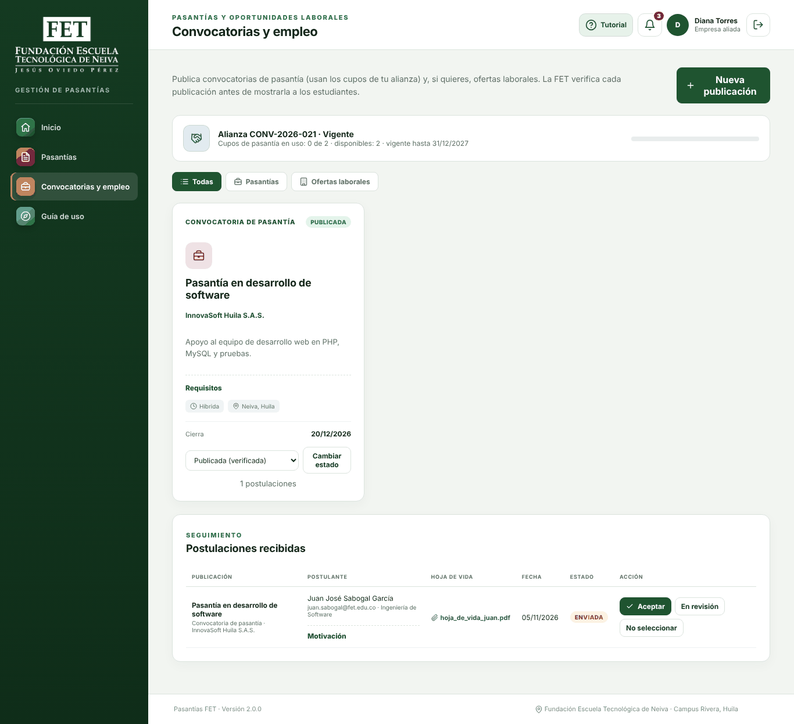
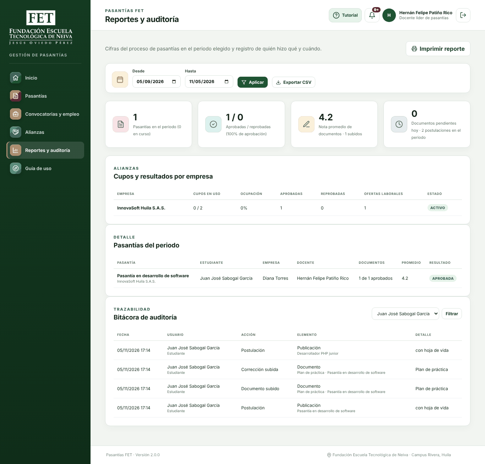

# Sesión simulada del plan de pruebas de usuario de Pasantías FET 2.0.0

Antes de la sesión de pruebas con los integrantes del equipo, se realizó una sesión simulada del plan de pruebas de usuario de Pasantías FET 2.0.0. El propósito fue anticipar los problemas de uso que podrían encontrar los participantes y corregirlos con tiempo, de modo que la sesión real se concentre en la percepción de las personas y no en fallas ya conocidas.

La simulación siguió el método del recorrido cognitivo, en el que un evaluador recorre cada tarea desde la perspectiva de un usuario nuevo y se pregunta, en cada paso, si esa persona sabría qué hacer y si entendería la respuesta del sistema (Wharton et al., 1994). Se recorrieron las veinticuatro tareas de los cuatro guiones: estudiante, empresa aliada, docente líder de pasantías y administrador.

## Método

### Participantes simulados

Cada guion se recorrió en el papel del participante asignado en el plan de pruebas: Juan José Sabogal García como estudiante, Hernán Felipe Patiño Rico como docente líder y Orlando Rojas Narváez como empresa aliada y como administrador. El recorrido se hizo con apoyo de un asistente de inteligencia artificial (Anthropic, 2026), que ejecutó las tareas en la plataforma y revisó cada pantalla. Por esa razón, los datos de este informe no representan la opinión de los integrantes del equipo.

### Ambiente y procedimiento

La sesión se realizó el 5 de noviembre de 2026 sobre el servidor de producción descrito en el informe de despliegue (Rojas Narváez et al., 2026a), con la base de datos recién instalada y en el orden de la sesión definido en el plan de pruebas. El resultado de cada tarea se comprobó en la plataforma, según la ejecución descrita en Rojas Narváez et al. (2026b).

Para cada tarea se registraron cuatro datos. El resultado indica si la tarea se completó. El tiempo es una estimación, en minutos, de lo que tardaría una persona que usa la plataforma por primera vez. La dificultad se calificó de 1 (muy fácil) a 5 (muy difícil). Las observaciones describen lo que podría confundir a un usuario nuevo. Los hallazgos se clasificaron por severidad según el plan de pruebas: alta cuando impiden completar la tarea, media cuando la tarea se completa con dificultad y baja cuando se trata de un detalle visual o de redacción.

No se aplicó la escala de usabilidad del sistema (SUS; Brooke, 1996), porque mide la percepción de cada persona y su puntaje solo tiene sentido con las respuestas de los participantes. Para interpretar los puntajes de la sesión real puede usarse la referencia de Bangor et al. (2008), según la cual un puntaje superior a 68 indica una usabilidad por encima del promedio.

## Resultados

### Resultado por tarea

Las veinticuatro tareas se completaron sin ayuda, lo que corresponde a una tasa de éxito del 100 %. El tiempo total estimado fue de 48 minutos y la dificultad promedio de 1,5 sobre 5. La Tabla 1 presenta el detalle por tarea y la Tabla 2 el resumen por perfil.

**Tabla 1**

*Resultado, tiempo estimado, dificultad y observación principal por tarea*

| Código | Perfil | Tarea | Resultado | Tiempo estimado (min) | Dificultad (1-5) | Observación principal |
|---|---|---|---|---|---|---|
| A1 | Administrador | Registrar alianza con empresa nueva | Completó | 4 | 3 | Formulario largo; la cuenta de la empresa pasaba inadvertida (H-08) |
| A2 | Administrador | Ampliar cupos | Completó | 1 | 1 | Directo; no acepta cero cupos |
| A3 | Administrador | Crear usuario y cambiar contraseña | Completó | 3 | 2 | El botón «Guardar» de cada fila es fácil de pasar por alto |
| A4 | Administrador | Desbloquear una cuenta | Completó | 2 | 1 | La cuenta bloqueada se identifica de inmediato |
| A5 | Administrador | Descargar respaldo | Completó | 1 | 1 | Faltaba explicar para qué sirve la huella SHA-256 (H-10) |
| E1 | Empresa | Entrar y revisar alianza | Completó | 1 | 1 | La alianza solo aparecía en *Convocatorias y empleo* (H-09) |
| E2 | Empresa | Publicar convocatoria | Completó | 3 | 2 | Claro; advierte que cada pasante ocupa un cupo |
| E3 | Empresa | Aceptar al estudiante | Completó | 3 | 3 | Se aceptaba con un selector y no con un botón (H-03) |
| E4 | Empresa | Avalar el plan de práctica | Completó | 2 | 2 | El diálogo reúne la descarga y la decisión |
| E5 | Empresa | Evaluar desempeño | Completó | 2 | 1 | Al editar, el estudiante recibía un aviso repetido (H-07) |
| E6 | Empresa | Publicar oferta laboral | Completó | 2 | 1 | Igual a la convocatoria; no usa cupos |
| D1 | Docente | Revisar el panel | Completó | 1 | 1 | El panel lleva directo a lo pendiente |
| D2 | Docente | Verificar convocatoria | Completó | 1 | 2 | El botón «Verificar» no publicaba sin cambiar antes el selector (H-04) |
| D3 | Docente | Asignarse a la pasantía | Completó | 2 | 2 | Se encuentra en *Pasantías sin responsables* |
| D4 | Docente | Devolver documento con nota baja | Completó | 3 | 2 | Mensaje de bloqueo claro con nota 2.5 |
| D5 | Docente | Aprobar la corrección | Completó | 1 | 1 | Mismo diálogo de D4 |
| D6 | Docente | Emitir veredicto final | Completó | 2 | 1 | El diálogo sugiere el resultado según el promedio |
| D7 | Docente | Reportes y auditoría | Completó | 3 | 2 | La bitácora mostraba números en lugar de nombres (H-06) |
| S1 | Estudiante | Entrar y ubicarse | Completó | 2 | 1 | Tutorial de 11 pasos |
| S2 | Estudiante | Postularse con hoja de vida | Completó | 2 | 1 | La convocatoria se encuentra desde el inicio |
| S3 | Estudiante | Subir plan de práctica | Completó | 2 | 1 | Directo |
| S4 | Estudiante | Corregir documento devuelto | Completó | 2 | 2 | La observación del docente está en texto pequeño dentro de la tabla |
| S5 | Estudiante | Consultar resultado final | Completó | 1 | 1 | El texto de *Avisos* mencionaba «compromisos» (H-05) |
| S6 | Estudiante | Aplicar a oferta laboral | Completó | 2 | 1 | Sin hoja de vida no permite enviar, como se espera |

*Nota.* El tiempo es una estimación para un usuario que usa la plataforma por primera vez. Las observaciones completas están en los guiones de esta carpeta.

**Tabla 2**

*Resumen por perfil*

| Perfil | Tareas | Tiempo estimado (min) | Dificultad promedio |
|---|---|---|---|
| Administrador | 5 | 11 | 1,6 |
| Empresa | 6 | 13 | 1,7 |
| Docente | 7 | 13 | 1,6 |
| Estudiante | 6 | 11 | 1,2 |

La tarea con mayor dificultad estimada fue el registro de una alianza (A1), por la longitud del formulario. Le siguió la aceptación de un estudiante por parte de la empresa (E3), porque la acción se hacía con un selector y no con un botón. El perfil de estudiante obtuvo la dificultad promedio más baja, lo que resulta coherente con que sus tareas consisten sobre todo en consultar información y subir archivos.

### Hallazgos

Se registraron diez hallazgos (ver Tabla 3). Los dos de severidad media se detectaron en la ejecución de los guiones en producción y se corrigieron antes de esta sesión. Los ocho de severidad baja se corrigieron después de la sesión simulada y se comprobaron con una nueva ejecución completa en el servidor de producción, en la que las veinticinco tareas se completaron.

**Tabla 3**

*Hallazgos de la sesión simulada y su estado*

| ID | Tarea | Descripción | Severidad | Corrección | Estado |
|---|---|---|---|---|---|
| H-01 | S1 | El tutorial no abría en ninguna pantalla por un error de JavaScript | Media | Se reconstruyeron los pasos del recorrido en `assets/js/tour.js` | Cerrado |
| H-02 | D4 | Ante un error dentro de una pasantía, la plataforma enviaba al listado de pasantías | Media | La plataforma regresa al detalle de la pasantía | Cerrado |
| H-03 | E3 | La postulación se aceptaba eligiendo «Aceptada» en un selector y pulsando «Guardar» | Baja | Botones «Aceptar», «En revisión» y «No seleccionar», con confirmación antes de crear la pasantía | Cerrado |
| H-04 | D2 | El botón «Verificar» no publicaba la convocatoria si antes no se cambiaba el selector a «Publicada» | Baja | Botón directo «Verificar y publicar»; el selector queda para los demás cambios de estado | Cerrado |
| H-05 | S5 | La pantalla *Avisos* mencionaba «compromisos asignados», de un módulo que ya no existe | Baja | Texto nuevo sobre pasantías y postulaciones | Cerrado |
| H-06 | D7 | La bitácora mostraba «Documento #1» o «Publicación #2» en lugar del nombre, y la corrección subida aparecía sin detalle | Baja | La bitácora muestra el título del documento, la publicación, la pasantía, la empresa o el usuario | Cerrado |
| H-07 | E5 | Al editar la evaluación de desempeño, el estudiante recibía un aviso idéntico al primero | Baja | Al editar, el aviso dice «La empresa actualizó tu evaluación» | Cerrado |
| H-08 | A1 | El formulario de nueva alianza era largo y la opción de crear la cuenta de la empresa pasaba inadvertida | Baja | El formulario se divide en dos secciones, y los datos de la cuenta nueva se ocultan si se elige una cuenta existente | Cerrado |
| H-09 | E1 | La información de la alianza solo aparecía en *Convocatorias y empleo* | Baja | La franja de la alianza también aparece en el inicio de la empresa | Cerrado |
| H-10 | A5 | La pantalla no explicaba para qué sirve la huella SHA-256 del respaldo | Baja | Texto explicativo en la pantalla de usuarios | Cerrado |

*Nota.* Las capturas de la carpeta `evidencias/produccion/` corresponden a la versión final, posterior a las correcciones.

**Figura 1**

*Postulaciones recibidas con los botones de aceptación (corrección H-03)*

**Figura 2**

*Bitácora de auditoría con el nombre de cada elemento (corrección H-06)*

## Conclusiones

La sesión simulada indica que los cuatro perfiles pueden completar sus tareas principales sin ayuda y que la plataforma está lista para la entrega con ajustes menores, que ya se aplicaron. Las reglas del proceso funcionan como se espera y sus mensajes son claros: el límite de cupos, la nota mínima de 3.0, la hoja de vida obligatoria en las ofertas laborales, el veredicto irreversible y el bloqueo por intentos fallidos.

Estos resultados no sustituyen la sesión con los integrantes del equipo. En ella deben registrarse los tiempos reales, la dificultad percibida, las observaciones de cada persona y el cuestionario SUS, en los guiones y en el formato de resultados de la carpeta superior. Si un participante tiene dificultades en una tarea que en esta sesión resultó fácil, la diferencia es un hallazgo en sí mismo y conviene registrarla.

## Referencias

Anthropic. (2026). *Claude* (Versión Opus 5.5) [Modelo de lenguaje de gran tamaño]. https://claude.ai

Bangor, A., Kortum, P. T., & Miller, J. T. (2008). An empirical evaluation of the System Usability Scale. *International Journal of Human-Computer Interaction, 24*(6), 574–594. https://doi.org/10.1080/10447310802205776

Brooke, J. (1996). SUS: A "quick and dirty" usability scale. En P. W. Jordan, B. Thomas, B. A. Weerdmeester, & I. L. McClelland (Eds.), *Usability evaluation in industry* (pp. 189–194). Taylor & Francis.

Rojas Narváez, O., Patiño Rico, H. F., & Sabogal García, J. J. (2026a). *Prueba de despliegue de Pasantías FET 2.0.0 en máquinas virtuales Ubuntu Server* [Informe técnico]. Fundación Escuela Tecnológica de Neiva.

Rojas Narváez, O., Patiño Rico, H. F., & Sabogal García, J. J. (2026b). *Ejecución de los guiones de prueba por perfil en el servidor de producción de Pasantías FET 2.0.0* [Informe técnico]. Fundación Escuela Tecnológica de Neiva.

Wharton, C., Rieman, J., Lewis, C., & Polson, P. (1994). The cognitive walkthrough method: A practitioner's guide. En J. Nielsen & R. L. Mack (Eds.), *Usability inspection methods* (pp. 105–140). John Wiley & Sons.
